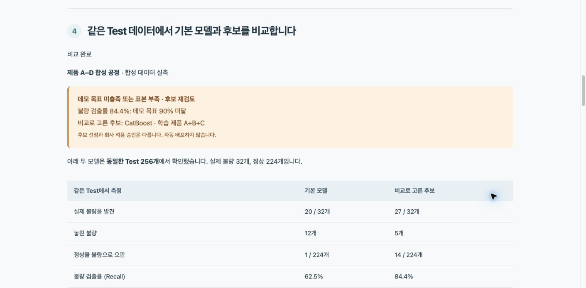

# 반도체 검사 모델 실험 도우미

**SKALA 광주 2반 · G045 김용찬 · 신규 AI Agent 과제 2**

검사 데이터를 점검하고 승인받아 여러 모델을 비교한 뒤, 선택 근거와 판정 성능을 보여 줍니다.

[최종 보고서](docs/REPORT.md) · [발표 PPTX](docs/G045_Semiconductor_Agent.pptx) · [발표 PDF](docs/G045_Semiconductor_Agent.pdf) · [5분 대본](docs/발표대본_G045.txt) · [과제 대응표](docs/ASSIGNMENT_CHECKLIST.md)

기존 [Google Slides](https://docs.google.com/presentation/d/1J2m_cpXyvb-5_Xabs2DsD3EnEV6B6GicF5OP2s5FohU/edit) 주소를 보존했습니다. 이번 수정의 원본은 이 저장소의 보고서와 PPTX입니다. Slides의 온라인 갱신 상태는 별도로 확인해야 합니다.

## 하나의 사용 흐름

데이터 선택 → 점검·근거 검색 → 계획 확인·승인 → 실제 학습 → Validation 후보 선택 → 같은 Test의 기본·후보 비교



## Windows에서 실행

`start.cmd`를 더블클릭하고 **http://localhost:8700**을 엽니다. 실행 창은 열어 둡니다.
새 설치는 PowerShell에서 `./start.ps1`로 Python 환경과 의존성을 준비합니다. Python 3.11 이상이 필요합니다.
이 작업 폴더에서는 상위 폴더의 `.venv`도 인식합니다. 처음에는 **예제 데이터 준비**를 누릅니다.
새 환경에는 과거 모델 파일과 DB가 없으므로 계획 승인 후 학습해야 새 실행 이력이 생깁니다.
저장된 실측 결과는 `docs/evaluation/`에서 확인할 수 있습니다.

macOS/Linux에서는 `bash start.sh`를 실행합니다. macOS의 XGBoost·LightGBM은 OpenMP 설치가 필요할 수 있습니다.

## 현재 모드와 LangSmith

`.env.example`을 참고해 로컬 `.env`를 설정합니다. 키는 Git에서 제외합니다.
APAC LangSmith에서 **실제 계획 생성과 하위 실행 기록의 API 재조회**를 확인했습니다.
[추적 증빙](docs/evaluation/langsmith_check.json) · [설정 안내](docs/LANGSMITH_SETUP.md)

현재 Windows에는 수업과 같은 Qwen2.5-1.5B-Instruct 계열의 양자화 모델을 로컬 Ollama로 연결했습니다.
실제 역할별 응답 검증은 [기록](docs/evaluation/local_llm_check.json)을 기준으로 확인합니다.
검색은 TF-IDF이며 LLM 추론과 임베딩 사용 여부를 각각 설정합니다.
`SEMI_LLM_ENABLED=1`, `SEMI_LLM_MODEL=qwen2.5:1.5b`, `SEMI_DENSE_ENABLED=0`이 현재 설정입니다.
첫 준비는 `scripts/setup_local_qwen.py`, 이후 Windows 실행 파일은 로컬 Ollama도 함께 시작합니다.
기존 Mac의 LLM 검증 기록은 [agent_integration.json](docs/evaluation/agent_integration.json)에 보존합니다.
LangSmith 연결과 LLM 응답 성공은 별개이며 UI에 verified/fallback/disabled 상태를 표시합니다.

## 고정한 조건과 결과

6:2:2를 사전에 고정했습니다. 합성 센서는 Train768 / Validation256 / Test256이며 같은 lot을 섞지 않습니다.
SECOM은 날짜 블록60/20/20이라 실제 행 수는 820 / 367 / 380입니다.
여러 모델과 불균형 설정을 비교한 뒤 상위 후보의 제품 조합을 확장합니다. 최대52조건이며 완전탐색이 아닙니다.
후보는 Validation에서 고르고 Test로 순위를 바꾸지 않습니다.

|같은 합성 센서 Test|기본 Logistic|선택 후보 CatBoost A+B+C|
|---|---:|---:|
|불량 발견|20/32|27/32|
|정상 오판|1/224|14/224|
|Recall|62.5%|84.4%|

후보 Recall이 교육용 목표90%에 못 미쳐 추가 실험이 필요합니다. 정상 오판 목표15%도 함께 확인합니다.
AdaBoost는 F1이 더 높지만 이번 Recall 우선 선택 규칙에서는 CatBoost가 앞섰습니다.
모델별 비교와 세 데이터의 결과는 [보고서](docs/REPORT.md)에 있습니다.
측정은 기존 Mac 실험 기록을 보존하며 Windows의 재검증은 별도 증빙으로 구분합니다.

## 구현 범위

LangGraph 역할 분리, 교육 근거14개 검색과 공식 문서 기반 새 모델 탐색, MCP4도구·Resource,
의존성 주입, 승인 hash, 실제 모델 학습·파일 저장, 모델 점검·재학습, 제품별 학습 비교를 구현했습니다.
외부 모델 탐색은 **ExtraTrees·GaussianNB의 검토된 adapter**를 지원합니다.
현재 RAG는 TF-IDF 또는 Qwen 임베딩·cosine 검색이며 별도 Vector DB는 없습니다.
로컬 LLM-as-a-Judge는 [평가 기록](docs/evaluation/llm_judge.json)에 있습니다. 작은 자체 개발 예제에 대한 결과이며 독립 평가가 아닙니다. 초기 실패도 보존합니다.
자율 Supervisor·임의 코드 생성·앙상블 혼합 가중치 탐색은 미구현입니다.

운영 모델은 자동 교체하지 않습니다. 회사 공통 Recall 수치, 양산 수율·금액 이득·작업시간 절감은 검증하지 않았습니다.
작은 불량 표본·반복 Validation과 추가 탐색의 Test 재사용이 한계이며 독립 기간 검증이 필요합니다.
교육 원본·제출 명단 엑셀·비밀 값은 공개 저장소에 넣지 않습니다.

## 검증과 재현

```powershell
$env:LANGSMITH_TRACING='false'
..\.venv\Scripts\python.exe -X utf8 -m unittest discover -s tests -v
..\.venv\Scripts\python.exe -X utf8 scripts/check_mcp.py
..\.venv\Scripts\python.exe -X utf8 scripts/check_langsmith.py
..\.venv\Scripts\python.exe -X utf8 scripts/build_report.py
```

독립 설치에서는 `..\.venv` 대신 `.venv`를 사용합니다. 발표 생성 패키지는 `requirements-presentation.txt`에 있습니다.
Windows에서는 SQLite 연결을 transaction 종료 후 명시적으로 닫아 DB 파일 잠금 문제를 수정했습니다.
SECOM: McCann & Johnston(2008), [UCI 원본](https://archive.ics.uci.edu/dataset/179/secom), DOI10.24432/C54305, CC BY4.0.
센서 원파일590열과 UCI 메타데이터591 features 표기를 구분합니다. 제조사·제품ID는 원자료에 제공되지 않습니다.
