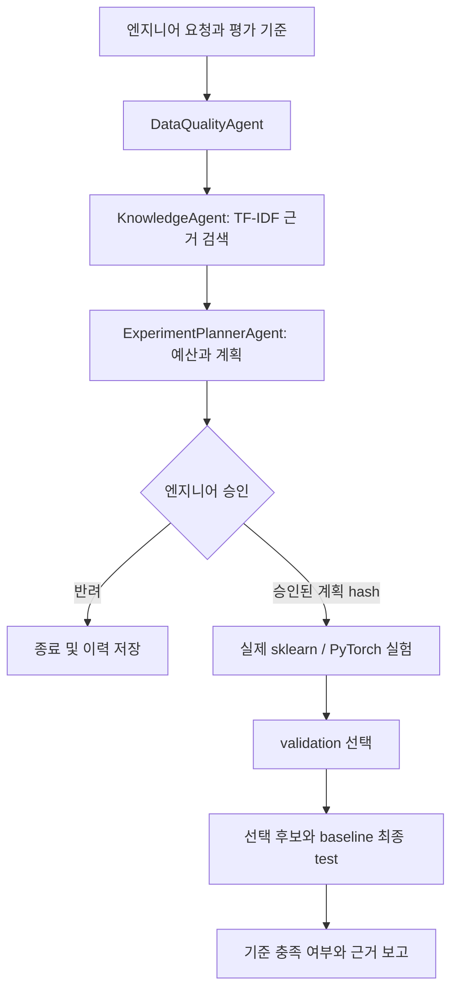

# Fab Experiment Copilot

**G045 김용찬 · SK AI Leader Academy · AI Mini-Project 과제 2(신규 프로젝트)**

[최종 보고서 Google Slides](https://docs.google.com/presentation/d/1J2m_cpXyvb-5_Xabs2DsD3EnEV6B6GicF5OP2s5FohU/edit) · [상세 보고서와 수치](docs/REPORT.md)

반도체 공정 엔지니어가 학습 데이터 범위·전처리·불균형 대책을 비교하고, 근거와 수치를 보고 실험을 승인하는 Agent입니다. 특정 회사 플랫폼에 종속되지 않는 독립 교육용 PoC입니다.


## 시작하기

Python 3.11 이상을 권장합니다. 최초 실행은 PyTorch 등 의존성을 설치하므로 인터넷과 여유 디스크가 필요합니다.

```bash
bash start.sh
```

브라우저에서 <http://localhost:8700>을 엽니다. `공개 데이터·합성 데모 준비`를 누르고 데이터를 선택한 다음 `근거와 실험 계획 제안받기`를 누릅니다. 이 단계는 **학습하지 않습니다**. 계획과 기준을 확인하고 `이 계획 승인 후 분석 실행`을 누르면 실제 모델을 학습합니다. `반려`하면 실행하지 않습니다.

네트워크 없이 실행하려면 최초 설치를 마쳐야 합니다. 공식 SECOM 아카이브는 저장소에 포함되어 있고 SHA-256으로 검증합니다.

## 구현한 기능

- 공정 CSV: Logistic Regression, Extra Trees, HistGradientBoosting 비교
- 검사 이미지: 자체 축소 ResNetSmall·VGGSmall·convolutional Autoencoder 실제 PyTorch 학습
- A, B, AB, ABC, ABCD 등 최대 15개 학습 제품 집합 비교. 모든 후보의 평가 대상과 평가 표본은 동일
- train 전용 결측 대체·분산 필터·표준화, 이미지 grayscale·contrast 비교
- class weight, 정상 전용 Autoencoder, calibration 임계값 선택으로 희소 불량 대응
- Recall·Precision·FPR·Average Precision·혼동행렬·Recall 신뢰구간·가정 비용 비교
- 승인 계획 및 데이터 SHA-256, 승인자, 실행 이력 저장. 변경·반려·중복 실행 차단
- 근거 검색, MCP 읽기·제안 도구, API, 결과 CSV 내보내기

## 실측 결과

2026-10-20, seed 45, CPU에서 실제 학습했습니다. 아래는 최종 test 결과이며, 모델 선택은 validation에서만 수행했습니다.

| 데이터 | 실험 수 | Before Recall | After Recall | After Precision | After FPR | 판단 |
|---|---:|---:|---:|---:|---:|---|
| 합성 공정 1,280행 | 60 | 60.0% | 100.0% | 53.2% | 13.2% | 합성 환경 파일럿 검토 |
| 공개 SECOM 1,567행 | 12 | 6.7% | 60.0% | 5.2% | 65.5% | **배포 보류** |
| 합성 이미지 576장 | 6 | 64.3% | 100.0% | 100.0% | 0.0% | 불량 평가 표본 14개, 보류 |

SECOM에서는 Recall을 높여도 오탐이 크게 늘어납니다. Agent는 이를 성공적인 운영 모델로 추천하지 않습니다. 합성 이미지의 100%는 쉽게 구분되는 인공 패턴의 결과이며 실제 검사 성능을 의미하지 않습니다. Before/After는 모델·전처리·임계값을 포함한 전체 실험 절차 비교이며 개별 기법의 인과 효과는 아닙니다.

전체 결과와 한계는 [최종 보고서](docs/REPORT.md), 수치 원본은 [평가 JSON](docs/evaluation/summary.json), 발표 설명은 [발표·코드 안내](docs/DEMO.md)를 참조하세요.

## 검증과 재현

```bash
.venv/bin/python -m unittest discover -s tests -v
.venv/bin/python scripts/check_mcp.py
.venv/bin/python scripts/evaluate.py
.venv/bin/python scripts/build_report.py
```

동일 데이터 hash·분할 hash·seed를 결과에 기록합니다. 실행 시간은 기기와 부하에 따라 달라집니다. 검증 환경은 `requirements.lock.txt`에 고정했습니다. 서로 다른 PyTorch 버전·기기까지 완전한 재현을 보장하지 않습니다.

## Agent 구조



LangGraph의 세 역할 노드는 데이터 검사·검색·계획을 수행하는 결정적 Python 함수입니다. 서로 독립적으로 추론하는 LLM Multi-Agent는 구현하지 않았습니다. 검색한 근거를 계획에 결합하지만 생성형 LLM 응답은 사용하지 않습니다. 외부 LLM 호출 비용은 0원입니다. LangSmith 추적 지점은 구현했으며 원격 업로드는 검증하지 않았습니다.

## MCP

```json
{
  "mcpServers": {
    "semiconductor": {
      "command": "/absolute/path/Semiconductor-AI-Agent/.venv/bin/python",
      "args": ["/absolute/path/Semiconductor-AI-Agent/mcp_server.py"],
      "env": {"LANGSMITH_TRACING": "false"}
    }
  }
}
```

도구는 `list_datasets`, `propose_experiment`, `get_experiment_result`입니다. AI가 스스로 승인하거나 학습 실행을 승인하는 도구는 노출하지 않습니다. 데모 준비는 웹에서 한 번 수행하세요. MCP는 실행 결과와 제안을 같은 SQLite 상태에서 조회합니다.

## 기업용 클라우드 확장

`Dockerfile`과 [Kubernetes 예시](deploy/kubernetes.yaml)를 제공합니다. 클라우드 실배포와 이미지 빌드는 아직 검증하지 않았습니다. 현재는 단일 프로세스·단일 학습 worker·SQLite이며 API가 분석을 수행합니다. 도입 시 SSO/RBAC, 별도 승인 권한, DB·Object Storage connector, worker queue, 중앙 감사 로그와 모델 registry를 추가해야 합니다.

```bash
docker build -t semiconductor-copilot:1.0 .
# ENGINEER_TOKEN은 배포 환경의 Secret으로 전달합니다.
docker run --rm -p 8700:8700 -e APP_ENV=production -e ENGINEER_TOKEN -v fab-state:/state semiconductor-copilot:1.0
```

`ENGINEER_TOKEN`이 있으면 `/api` 전체가 토큰을 요구합니다. 데모 UI의 토큰 입력란에 입력할 수 있습니다. production 모드에서는 토큰 없이 서버가 시작하지 않습니다. 현재 토큰은 공유 토큰이므로 실제 기업의 개인별 권한 체계를 대체하지 않습니다.

## 데이터와 범위

- [UCI SECOM](https://archive.ics.uci.edu/dataset/179/secom): McCann & Johnston(2008), CC BY 4.0. 실제 파일의 센서 열 590개, 불량 104개. 원본 pass=-1은 정상0으로, fail=1은 불량1로 변환
- 합성 공정·이미지: 코드로 생성한 데모. 실제 회사·장비·제품 데이터가 아님
- 제공 교육·아이디어 자료의 원본 사진과 PDF는 저장소에 재배포하지 않음
- 실제 제품 식별자가 없는 SECOM에 A/B/C 라벨을 붙이지 않음
- GAN, NLP 로그 분석, LSTM/ARIMA 시계열, SEM 길이 계측은 향후 확장. 이번 구현의 성능 검증 범위에 포함하지 않음

제출용 명단 Excel은 개인 정보가 포함된 별도 양식이므로 이 공개 저장소에 업로드하지 않습니다.
