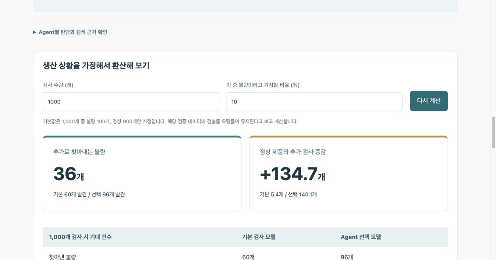

# 반도체 검사 모델 관리 Agent

G045 김용찬 / SK AI Leader Academy / 과제2 신규 프로젝트

[최종 보고서 Google Slides](https://docs.google.com/presentation/d/1J2m_cpXyvb-5_Xabs2DsD3EnEV6B6GicF5OP2s5FohU/edit) / [상세 보고서](docs/REPORT.md) / [발표 대본 TXT](docs/발표대본_G045.txt)

불량 추가 발견과 정상 제품 추가검사 부담을 비교합니다. 새 데이터에서 재학습 필요를 판단하고,엔지니어 승인 후 공통·제품 전용 모델을 생성해 같은 제품의 평가에서 학습 방식을 권고하거나 보류합니다. 공개·합성 데이터의 교육용 PoC입니다.



## 시작하기

```bash
bash start.sh
```

http://localhost:8700 에서 연습용 공정 데이터와 완료된 예시 결과 바로 보기를 선택합니다. 새 설치에는 실행 이력이 없으므로 예제 데이터 준비 후 비교 계획을 생성하고 승인합니다. **계획 생성만으로 학습하지 않습니다.** 승인한 계획만 실행하고 반려·중복 실행은 차단합니다.

Python3.11 이상과 최초 의존성 설치가 필요합니다. SECOM 공식 ZIP은 저장소에 포함되어 SHA256으로 확인합니다. [시연 순서](docs/DEMO.md)

## 교육에서 다룬 모델

공정 후보: **Decision Tree·Random Forest·Gradient Boosting·XGBoost·LightGBM·CatBoost·KNN·SVM·MLP·Logistic·AdaBoost·Hist Gradient Boosting 12종**. 이미지 후보: 교육용 축소 ResNet·VGGNet 계열,Autoencoder. [교육 자료명·페이지와 구현 구분](docs/CURRICULUM_MODELS.md)

Random Forest는 스칼라 실습과 반도체 자료 모두에서 확인했습니다. 이미지 축소 구조는 표준 ResNet18/VGG16 사전학습 비교가 아닙니다. NLP·시계열과 수율 예측은 향후 범위입니다.

## 구현한 기능

- 데이터 종류별 후보와 전처리 이유 설명,모델12종 비교 후 상위2종의 최대15개 제품 학습 범위 확장
- train 전용 결측·상수 제거·스케일 처리,빈도 가중치 또는 train 전용 복제,정상 전용 Autoencoder
- 근거 검색과 승인 계획·데이터 hash 고정,학습·평가·CSV 내보내기
- 검사 수량·불량률에 따른 추가 검출량과 검사 부담,손실·재작업 가정 계산
- 새 배치 성능 점검,승인 후 공통1개·제품별4개 후보의 실제 학습과 버전 저장
- 동일 제품 validation으로 공통/전용 방식 선택,test 기준 미달이면 보류

## 실제 측정 결과

| 데이터 | 후보 수 | Before Recall | After Recall | After Precision | After FPR | 판단 |
|---|---:|---:|---:|---:|---:|---|
| 합성 공정 | 52 | 60.0% | 96.0% | 48.0% | 15.6% | 보류 |
| 공개 SECOM | 24 | 6.7% | 93.3% | 6.0% | 88.8% | 보류 |
| 합성 이미지 | 6 | 64.3% | 100.0% | 100.0% | 0.0% | 보류 |

합성 공정도 최종 정상 추가검사15.6%로 허용15%를 조금 넘어 적용을 보류했습니다. 공개 SECOM 역시 보류 사례로 보고합니다. 합성 이미지100%는 단순한 인공 패턴이며 현장 성능으로 일반화할 수 없습니다. 모델·전처리·임계값을 포함한 절차 비교로 개별 기법의 인과 효과는 아닙니다.

## 건수와 비용을 쉽게 읽기

제품1,000개 중 불량100개·정상900개와 검증 비율 유지라는 **가정**입니다. 기본 모델은 불량60.0개, 선택 모델은96.0개를 찾습니다. 불량36.0개를 더 찾는 대신 정상 추가검사는5.4개에서140.1개로134.7개 늘어납니다.

미검출1개10만원·정상 추가검사1개1천원 가정에서는 손실4,005,389원에서540,120원, 차이3,465,269원입니다. 재작업·설비·처리량·매출 효과를 제외하여 실제 영업이익으로 해석하지 않습니다.

두 모델의 검출 불량 중20%를 재작업으로 정상화한다는 별도 가정에서는 양품7.2개를 추가 회수합니다. **재작업 후 양품 비율**은91.2%에서91.9%, 차이0.72%p입니다. 실제 결함의 재작업 가능성과 제조 수율 향상은 검증하지 않았습니다.

## 통합·제품별 재학습 비교

기존 모델의 이전 test Recall96.0%와 새 배치 train 점검39.2%를 비교해 재학습을 제안했습니다. 서로 다른 배치의 비교이며 통계적 drift 검정은 아닙니다.

| 제품 | 공통 Recall / FPR | 전용 Recall / FPR | 선택 방식 | 최종 판단 |
|---|---:|---:|---|---|
| A | 95.1% / 14.3% | 87.8% / 10.9% | 공통 | 공통 모델 권고 |
| B | 92.9% / 16.3% | 92.9% / 21.7% | 공통 | 적용 보류 |
| C | 92.3% / 12.8% | 92.3% / 12.8% | 전용 | 제품 전용 모델 권고 |
| D | 100.0% / 12.9% | 91.7% / 14.3% | 공통 | 적용 보류 |

표는 같은 제품의 같은 validation에서 비교합니다. test는 방식 선택에 쓰지 않고 최종 확인에만 사용합니다. 새 배치 안에서 통합·전용 학습을 비교하며 과거 파일을 자동 병합하지 않습니다. 운영 모델 자동 교체는 없습니다. [실제 점검·학습 기록](docs/evaluation/model_management.json)

## 검증과 재현

```bash
.venv/bin/python -m unittest discover -s tests -v
.venv/bin/python scripts/check_mcp.py
.venv/bin/python scripts/evaluate.py
.venv/bin/python scripts/evaluate_management.py
.venv/bin/python scripts/build_report.py
```

26개 테스트와 실제 MCP stdio 연결을 검증했습니다. 평가 스크립트의 승인자는 명시적인 자동 테스트 actor이며 현장 승인 실적이 아닙니다. 데이터·분할 hash,seed와환경은 JSON 및 requirements.lock.txt에 기록합니다. 기기·라이브러리 차이까지 완전한 재현을 보장하지 않습니다.

## Agent와 운영 범위

로컬 Qwen의 품질 점검·계획·결과 검토 역할, LangGraph, 13문서 임베딩 RAG, DI, MCP 4도구, 모듈화·26개 테스트를 구현했습니다. LLM 판단은 허용 코드·출처 연결을 검사하며 실패하면 규칙 설명으로 대체합니다. 수치와 승인은 분석 엔진이 관리합니다. [실제 LLM·검색 평가](docs/evaluation/agent_integration.json)

로컬 LLM과 임베딩을 쓰려면 Ollama에 qwen3.5:2b 및 qwen3-embedding:0.6b가 있어야 합니다. `SEMI_LLM_ENABLED=1 bash start.sh`로 켭니다. 기본값은 규칙·TF-IDF 모드이며 이 상태도 화면에 표시합니다. macOS의 XGBoost·LightGBM에는 OpenMP가 필요해 `brew install libomp`를 먼저 실행합니다. requirements.lock.txt는 검증 환경의 고정 버전입니다.

LangSmith 계측을 추가했고 실제 원격 전송은403 권한 오류로 확인하지 못했습니다. 성공한 것으로 표시하지 않았습니다. 유효한 환경 변수는 실행 프로세스에만 설정하고 비밀을 Git에 올리지 않습니다.

Dockerfile과 deploy/kubernetes.yaml은 기업 클라우드 확장 예시이며 빌드·실배포는 검증하지 않았습니다. production에서는 ENGINEER_TOKEN을 설정해야 API를 사용할 수 있습니다. 현재 공유 토큰·SQLite·단일 worker는 개인별 SSO/RBAC·대규모 worker·중앙 감사 체계를 대체하지 않습니다.

## 외부 모델 발굴 (확장 설계)

외부 검색으로 모델을 찾고 RAG로 문서와 실험 이력을 참고한 뒤, 승인된 동일 조건 실험을 통과한 후보 목록을 갱신하는 설계입니다. 현재 실행 기능은 미구현이며 [상세 설계](docs/MODEL_DISCOVERY_DESIGN.md)로 구분했습니다.

## 데이터 형식과 출처

공정 CSV에는 label(정상0/불량1),product,lot_id 또는 timestamp와 숫자 센서 열을 넣습니다. 이미지 ZIP은 manifest.csv와 image_path의 상대 이미지 파일로 구성합니다. 이미지 manifest에도 label·product·lot_id 또는 timestamp가 필요합니다. 업로드30MB,압축 해제128MB,실험72조건,제품4개,행20,000개로 제한합니다.

[UCI SECOM](https://archive.ics.uci.edu/dataset/179/secom)은CC BY4.0입니다. 센서590열·표본1,567·불량104입니다. 교육 PDF·아이디어 사진과 제출용 명단 엑셀은 공개 저장소에 넣지 않았습니다.
