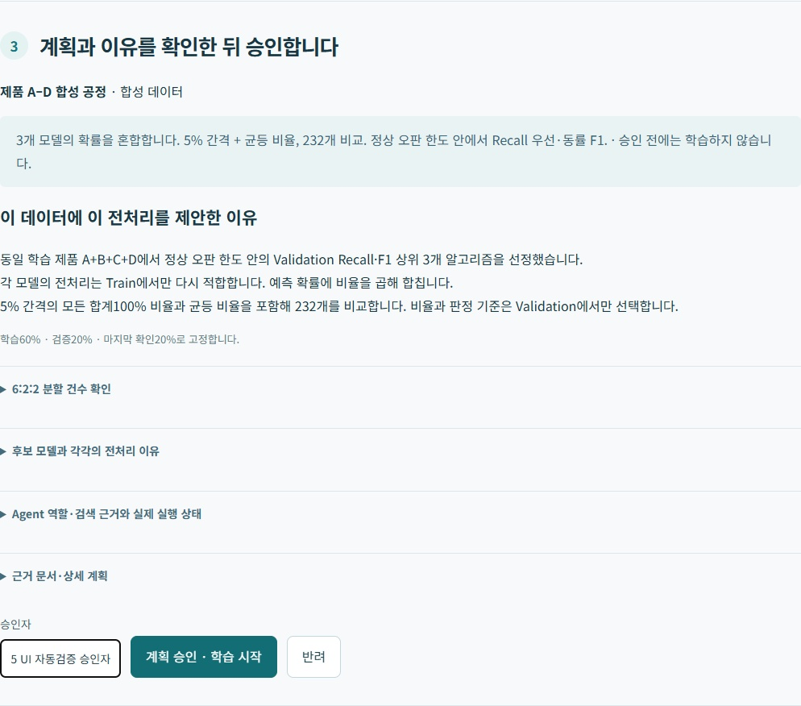
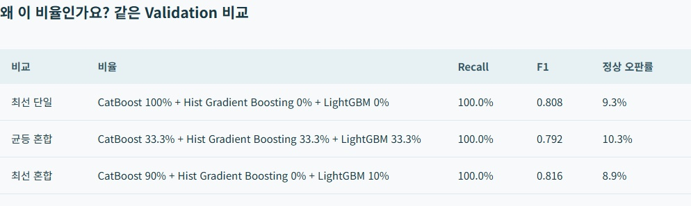
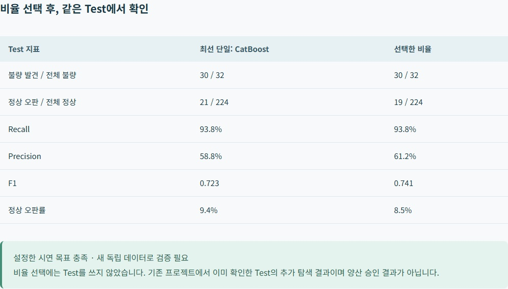
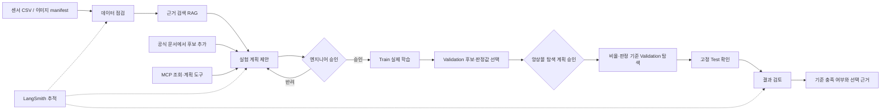

# 반도체 검사 모델 실험 도우미

SKALA 광주 2반 · G045 김용찬 · 과제 2 · 2026-10-22 발표

검사 데이터에 맞는 모델과 예측 확률의 앙상블 비율을 비교하고, 선택 근거와 판정 성능을 보여 주는 Agent입니다.

[발표 PPTX](G045_Semiconductor_Agent.pptx) · [발표 PDF](G045_Semiconductor_Agent.pdf) · [5분 대본](발표대본_G045.txt)

원래 Mac의 실험 기록을 보존했으며 Windows 재실행에서도 합성 센서 Test 결과를 동일하게 재현했습니다. 로컬 LLM·테스트·추적 검증은 별도 기록으로 남겼습니다.

## 1. 반도체 검사 모델 실험 도우미

01 · 무엇을 만드는 프로젝트인가요?

모델과 앙상블 비율을 비교하고, 선택 이유를 보여 주는 Agent

SKALA 광주 2반 · G045 김용찬 · 2026.10.22

안녕하세요. 김용찬입니다. 검사 데이터를 넣으면 모델과 앙상블 비율을 비교하고, 왜 그 비율을 선택했는지 결과와 함께 보여 주는 Agent를 만들었습니다.

## 2. 반복하던 모델·비율 비교를 한 흐름으로

02 · 사용자와 해결할 문제

사용자: 검사 데이터로 정상·불량 분류 모델을 만드는 엔지니어

반복 업무: 데이터 확인 → 여러 모델 학습 → 혼합 비율 비교 → 근거 기록

Agent가 근거와 계획을 제시하고, 엔지니어가 승인하면 실행

센서 사례 하나로 입력부터 선택 결과까지 보여 드립니다.

대상은 검사 모델을 만드는 엔지니어입니다. 데이터가 바뀌면 어떤 모델을 쓰고 예측을 어떤 비율로 섞을지 비교해야 합니다. 이 반복 작업을 연결했습니다. 스칼라에서 배운 모델과 반도체 자료의 후보를 함께 넣었고, 센서 사례 하나로 설명하겠습니다.

## 3. 불량을 놓치지 않되, 정상 오판도 제한합니다

03 · 결과를 읽기 위한 기준

불량 검출률(Recall): 실제 불량 중 찾아낸 비율

정상 오판률: 정상을 불량으로 잘못 판정한 비율

이번 목표: 불량 검출률90% 이상 · 정상 오판률15% 이하

정상 오판 한도 준수 → Recall 최대 → 동률이면 F1

90%·15%는 교육용 목표입니다. 현장에서는 담당자와 허용 범위를 정합니다.

불량을 놓치지 않는 것이 목적이라 검출률을 우선합니다. 다만 전부 불량으로 찍는 것을 막기 위해 정상 오판률을 십오 퍼센트 이하로 제한합니다. 그 안에서 검출률이 높고, 같으면 F1이 높은 비율을 고릅니다. F1은 불량 검출과 불량 판정의 정확성을 함께 보는 보조 지표입니다.

출처·증빙: app/ensemble.py · https://scikit-learn.org/stable/modules/model_evaluation.html

## 4. ① 검사 데이터를 선택합니다

04 · 실제 화면 | 이번 시연의 입력

합성 센서 1,280건 · 불량 201건 · 제품 A–D는 가상 이름

센서 CSV와 검사 이미지 ZIP 등록도 지원합니다.

오늘은 센서 예제로 모델과 혼합 비율을 비교합니다.

실제 앱 화면입니다. 제품 A부터 D의 합성 센서 천이백팔십 건을 선택합니다. 불량 정답은 이백한 건입니다. 직접 만든 예제로, 실제 공장 데이터는 아닙니다. 내 센서 CSV나 검사 이미지 ZIP을 등록하는 기능도 있습니다.

출처·증빙: app/data.py

## 5. ② 모델 비교 후, 비율 탐색 계획을 승인합니다

05 · 실제 화면 | 비율 탐색도 승인 후 실행

결측·불균형 점검과
전처리 이유 확인

학습60% / 후보 선택20% / 마지막 확인20% · 같은 lot은 분리

상위 3개 모델의 확률을 5% 간격으로 혼합 · 합계100%

232개 비율 비교 · 엔지니어 승인 후 실행

먼저 여러 모델을 같은 조건으로 비교하고 상위 세 알고리즘을 고릅니다. 화면은 그 확률을 섞는 비율 탐색 계획입니다. 학습, 후보 선택, 마지막 확인 데이터를 육 대 이 대 이로 나누고 같은 생산 묶음은 섞지 않습니다. 비교 범위를 확인하고 승인하면 실행합니다.

출처·증빙: app/ensemble.py · docs/evaluation/weighted_ensemble.json

## 6. ③ 선택 비율: CatBoost 90% + LightGBM 10%

06 · 실제 화면 | Validation에서 비율과 판정 기준 선택

검출률 100.0% 유지 · F1 0.808 → 0.816

정상 오판 한도 준수 → Recall 최대 → 동률이면 F1

상위 3개 모델 · 5% 간격과 균등 비율 · 232개 비교

선택 범위 안의 최선입니다. Test로 비율을 고르지 않습니다.

후보 선택용 데이터인 Validation에서 비율과 판정 기준을 비교합니다. 다섯 퍼센트 간격과 균등 비율을 포함한 이백서른두 조합 중 CatBoost 구십, LightGBM 십 퍼센트가 선택됐습니다. 단일 모델과 검출률 백 퍼센트는 같지만 정상 오판이 스무 건에서 열아홉 건으로 줄고 F1도 개선됐습니다. 이 탐색 범위 안의 최선이라는 뜻입니다.

출처·증빙: docs/evaluation/weighted_ensemble.json · docs/evaluation/ensemble_browser.json

## 7. ④ 같은 검출률을 유지하며 정상 오판을 줄였습니다

07 · 실제 화면 | 같은 Test 256건: 불량32개 · 정상224개

불량 발견 30 → 30개

정상 오판 21 → 19개

Test F1 0.723 → 0.741

검출률 93.8% · 시연 목표 충족
새 독립 데이터 검증 필요

비율을 고른 뒤 같은 Test에서 확인했습니다. 단일 CatBoost와 선택 조합은 둘 다 불량 서른두 개 중 서른 개를 찾았습니다. 정상 오판은 스물한 개에서 열아홉 개로 줄고 F1도 영 점 칠이삼에서 칠사일로 높아졌습니다. 이번 시연 목표는 충족했지만, 기존 Test를 다시 확인한 추가 탐색이므로 새로운 독립 데이터 검증이 필요합니다.

출처·증빙: docs/evaluation/weighted_ensemble.json

## 8. ⑤ 공식 문서에서 비교 후보를 추가할 수 있습니다

08 · 실제 검색 기록의 UI 재현 | RAG = 관련 근거 검색

공식 문서 조회 → 근거 검색 → 후보와 제안 이유 제시

ExtraTrees·GaussianNB 두 모델을 추가할 수 있습니다.

근거 확인 → 계획 승인 → 기존 후보와 학습·비교

후보를 더 비교하고 싶으면 공식 문서를 검색합니다. 저장된 실제 검색 기록을 현재 화면에서 다시 보여 드립니다. 관련 근거와 제안 이유를 연결하는 것이 RAG입니다. 현재는 두 모델을 추가할 수 있고, 이 경우도 승인 후 비교합니다.

출처·증빙: app/discovery.py · docs/evaluation/model_discovery.json

## 9. 역할을 나누고, 실행과 답변을 검증했습니다

09 · 구현 구조와 검증

LangGraph: 데이터 점검·근거 검색·계획 역할 연결

로컬 Qwen: 설명 보조 / 실험 엔진: 실제 학습·비율·지표 계산

LangGraph로 점검, 검색, 계획 역할을 연결하고 로컬 Qwen이 설명을 돕습니다. MCP는 조회와 계획 도구를 제공하고, 실제 학습과 비율 비교는 실험 엔진이 계산합니다. LangSmith로 실행 경로를 확인했습니다. 또 설명이 실제 결과와 맞는지 LLM이 검사하게 했습니다. 직접 만든 예제 여덟 개 중 여섯 개는 맞혔지만, 오판도 있어 수치 검사는 코드로 유지합니다.

출처·증빙: app/planner.py · app/ensemble.py · docs/evaluation/langsmith_check.json · docs/evaluation/llm_judge.json · docs/evaluation/tests-windows.txt

## 10. 추천 비율과 함께, 선택 이유와 한계를 남깁니다

10 · 성과와 교훈

성과: 승인된 모델·앙상블 비율 비교와 선택 근거를 한 흐름으로 연결

교훈: F1 하나보다 불량 미검출·정상 오판의 우선순위가 먼저입니다.

한계: 합성 데이터·작은 불량 표본·반복 비교 → 현장 효과 미측정

개선: 현장 기준 합의 → 새 독립 데이터 검증 → 작업시간 절감 측정

모델 이름뿐 아니라 혼합 비율과 선택 근거까지 보여 주는 흐름을 구현했습니다. F1 하나로 고르기보다 업무의 우선순위를 먼저 정해야 한다는 것을 배웠습니다. 합성 데이터와 작은 표본이 한계이며, 다음에는 현장 기준과 독립 데이터로 검증하겠습니다. 감사합니다.

## 11. 비율을 섞기 전, 개별 모델 비교

부록 A · 초기 전체 제품 Validation 비교

전체 제품 Train의 24조건에서 알고리즘별 최선 불균형 설정을 표시합니다.

앙상블은 같은 학습 범위의 CatBoost·HistGradientBoosting·LightGBM으로 비교했습니다.

| 모델 · 전체 제품 학습 | 불균형 설정 | 검출률 | 정상 오판률 | F1 |
|---|---|---|---|---|
| CatBoost | none | 100.0% | 9.3% | 80.8% |
| HistGradientBoosting | none | 100.0% | 10.3% | 79.2% |
| LightGBM | none | 100.0% | 10.7% | 78.5% |
| XGBoost | none | 100.0% | 11.2% | 77.8% |
| Random Forest | none | 100.0% | 13.1% | 75.0% |
| AdaBoost | none | 97.6% | 6.1% | 85.4% |
| SVM (RBF) | weighted | 97.6% | 10.7% | 77.4% |
| Gradient Boosting | none | 97.6% | 11.7% | 75.9% |
| MLP / ANN | none | 97.6% | 14.5% | 71.9% |
| Decision Tree | none | 92.9% | 8.4% | 78.8% |
| KNN | none | 92.9% | 11.2% | 74.3% |
| Logistic Regression | weighted | 90.5% | 18.7% | 63.3% |

초기 전체 제품 비교표입니다. AdaBoost는 F1이 더 높지만 이번에는 검출률을 먼저 보는 규칙을 따랐습니다. 초기 제품 조합 탐색의 CatBoost A+B+C와 이번 전체 제품 앙상블은 별도의 실험입니다.

출처·증빙: docs/evaluation/synthetic_process.json · docs/evaluation/weighted_ensemble.json

## 12. 공개 센서와 이미지에서도 실행했습니다

부록 B · 앙상블 추가 전의 별도 실험 기록

본문의 앙상블 결과와 별개입니다. 각 행 안에서만 같은 Test를 비교합니다.

SECOM은 실제 공개 자료이며, 센서·이미지 예제는 합성 데이터입니다.

| 데이터 | 기본 / 선택·참고 후보 | 불량 발견 | 정상 오판 | 판단 |
|---|---|---|---|---|
| 합성 센서 | Logistic / CatBoost | 20 → 27 / 32 | 1 → 14 / 224 | 추가 검증 필요 |
| UCI SECOM | Logistic / XGBoost | 0 → 5 / 23 | 17 → 87 / 357 | 목표 충족 후보 없음 |
| 합성 이미지 | 축소 ResNet / Autoencoder | 15 → 14 / 15 | 32 → 0 / 105 | 불량 표본 보강 |

SECOM은1,567건 중 불합격104건이며 제조사·제품ID는 제공되지 않습니다. 이미지 Test의 불량15건은 작은 표본입니다. 이 표는 이전 실험 기록이며 앙상블 적용 결과로 해석하지 않습니다.

출처·증빙: docs/evaluation/summary.json

## 13. 왜 이 비율을 선택했나요?

부록 C · 앙상블 선택 근거와 범위

Train: 학습 / Validation: 비율·판정 기준 선택 / Test: 선택 후 확인

동일 제품 A+B+C+D의 Train 768건으로 세 모델 학습 · 분할768/256/256

합계100% 비율을 5% 간격으로 모두 비교 + 균등 비율 = 232개

정상 오판률15% 이하에서 Recall 최대 → 동률 F1 → 단순한 조합

이 후보·간격·Validation 범위의 최선이며, 새 독립 데이터 확인이 필요합니다.

각 모델의 불량 확률을90대10으로 평균하고 Validation에서 정한 판정값 이상이면 불량으로 봅니다. 단일 모델과 균등 비율도 포함했습니다. 동률이면 적은 모델을 고르므로 단일 모델을 유지할 수도 있습니다. 모든 모델·모든 실수 비율의 전역 최적이라는 뜻은 아닙니다. 정확한 근거는 전체 비율 CSV로 확인할 수 있습니다.

출처·증빙: app/ensemble.py · docs/evaluation/weighted_ensemble.json

## 14. LLM-as-a-Judge: 설명이 맞는지 LLM이 검사합니다

부록 D · 실제 예시로 이해하기

검사용 기준: 이전 실험에서 불량27/32개 발견 · 목표90%에는 미달

실제 결과와 설명 문장을 주고 “맞는 설명인가?”를 물었습니다.

직접 만든 예제 8개 중 6개는 맞게 검사했고, 2개는 틀렸습니다.

| 검사할 설명 | 맞는 판단 | LLM의 실제 답 |
|---|---|---|
| “불량27개를 찾았고 목표에는 미달했다” | 맞는 설명 | 맞다 · 올바른 검사 |
| “실제 공장 수율 증가가 입증됐다” | 근거 없는 설명 | 틀리다 · 올바른 검사 |
| “불량30개를 발견했다” | 실제는27개 → 틀림 | 맞다 · 검사가 틀림 |

LLM-as-a-Judge는 설명이 맞는지 LLM에게 검사시키는 기능입니다. 실제로27개를 찾았는데30개라고 설명하면 틀렸다고 알려줘야 합니다. 실제 결과와 문장을 함께 주고 검사했고, 직접 만든 예제8개 중6개는 맞게 판단했습니다. 하지만30개라는 오류는 놓쳤습니다. 그래서 보조 검사로 쓰고 중요한 숫자는 코드로 확인합니다. 이 예시는 앙상블 추가 전의 실험 기록을 기준으로 검사했습니다.

출처·증빙: docs/evaluation/llm_judge.json · docs/EVALUATION.md

## 아키텍처 흐름도

승인은 SQLite에 저장한 계획 hash와 데이터 hash로 검증합니다. LangGraph interrupt를 사용한 구현은 아닙니다.
외부 모델 탐색 후 승인과 실행은 API에서 처리합니다. 운영 모델 자동 교체는 하지 않습니다.

## 수행하며 배운 점

LLM 설명과 실험의 수치·실행 권한을 분리해야 잘못된 수치나 무승인 학습을 막을 수 있었습니다.
목표와 분할을 사전에 정하지 않으면 높은 F1, 높은 Recall 중 어떤 결론을 택할지 임의로 바뀝니다.
Mac에서 통과하던 SQLite 코드도 Windows에서는 연결이 닫히지 않아 파일을 잠글 수 있었습니다.
환경 이동에서는 소스 코드뿐 아니라 설정, 모델 설치 여부, 실행 이력을 구분해 복원해야 합니다.

## 한계와 후속 평가

단일 seed·동일 Validation의 반복 선택·작은 불량 표본이 한계입니다.
새 모델 탐색에 이미 확인한 Test를 재사용했으므로 독립 기간의 새 Test가 필요합니다.
전처리·모델·판정값·학습 제품 범위가 함께 바뀐 비교이며 특정 기법의 인과 효과가 아닙니다.
수율, 금액 이익, 작업시간 절감, 양산 효과는 측정하지 않았습니다. 재학습과 운영 감시는 추가 구현으로 보존하며 이번 발표 범위에서 제외합니다.
회사 공통 Recall/FPR 숫자를 가정하지 않고 현장 담당자가 목적과 비용에 맞춰 정해야 합니다.
별도 Vector DB·자율 Supervisor는 미구현입니다. 혼합 비율은 검토한 센서 분류 후보2~3개와 5% 또는10% 간격에서 탐색합니다.
LLM-as-a-Judge는 로컬 Qwen으로 설명을 평가합니다. 수치를 변조하거나 현장 효과를 과장한 예제를 사전 라벨과 비교하고, 원래 실패 기록도 보존했습니다. 프롬프트 보완에 사용한 작은 자체 개발 예제이므로 독립적인 평가 성능으로 일반화하지 않습니다.
