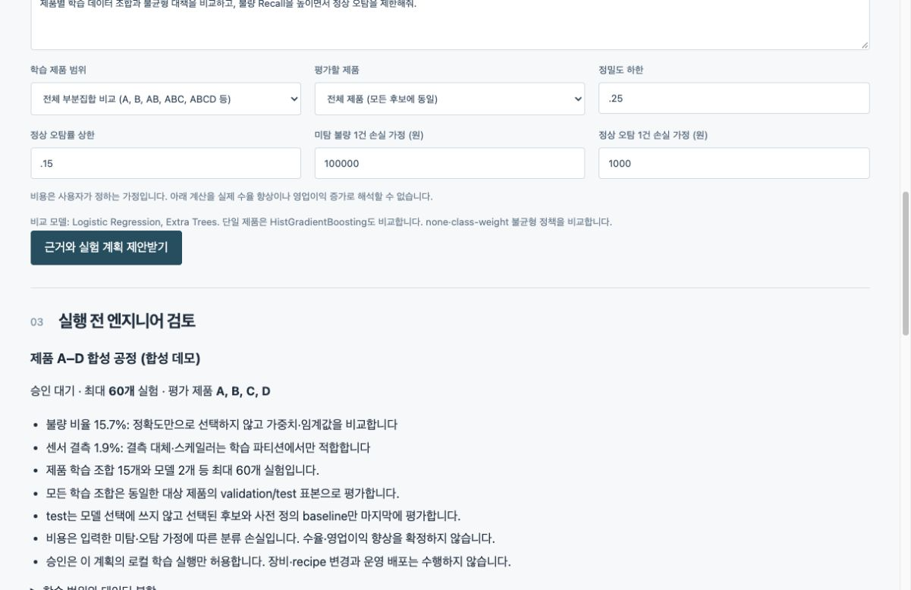
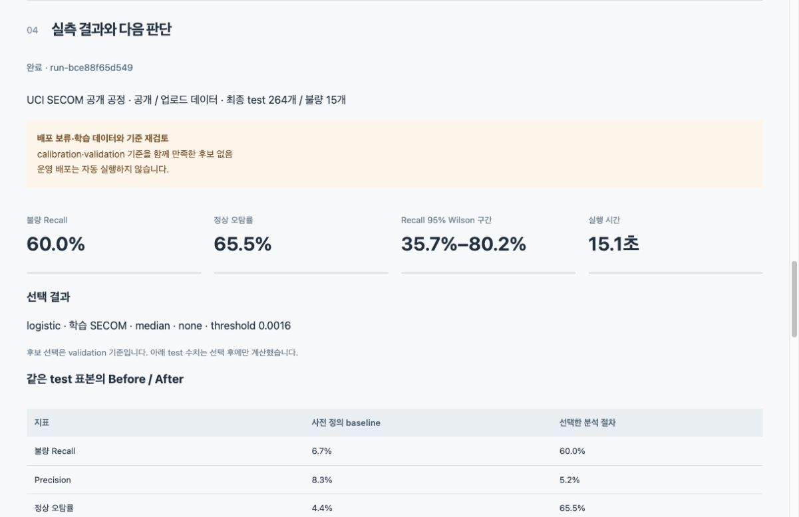

# Fab Experiment Copilot 최종 보고서

**G045 김용찬 · SK AI Leader Academy · 과제 2 신규 프로젝트 · 2026-10-20**

## 1. 해결하려는 문제

반도체 불량 탐지에서는 데이터가 정상에 치우치고, 제품별 분포가 달라 어떤 학습 집합과 전처리·모델이 적절한지 반복 실험이 필요하다. Recall만 높이면 정상 제품의 불필요한 재검사와 과검출이 늘어날 수 있다. 이 프로젝트는 데이터 품질과 근거를 제시하고 엔지니어 승인 후 실제 모델을 비교하는 Agent를 구현했다.

목표는 교육용 분석·의사결정 보조다. 특정 회사 플랫폼용 연동은 범위에서 제외했다. 기업용 클라우드에서 사용할 수 있는 구조로 확장할 수 있으며 실제 클라우드 배포는 별도 검증이 필요하다.

## 2. 구현 범위와 사용자 흐름

1. 공정 CSV 또는 manifest.csv를 포함한 이미지 ZIP을 등록한다.
2. 정상0·불량1, 결측·중복·제품·lot·시각을 검사한다.
3. 학습 제품 범위와 Precision·FPR·비용 가정을 입력한다.
4. Agent가 관련 근거, 데이터 품질 경고, 모델 후보, 최대 실험 수를 제시한다. 이 시점에는 학습하지 않는다.
5. 엔지니어가 해당 SHA-256 계획을 승인하거나 반려한다.
6. 승인된 계획만 실제 학습하고 validation 결과로 후보를 선택한다. 마지막에 동일한 test 표본으로 baseline과 선택 후보를 비교한다.
7. 배포 보류 사유, 혼동행렬과 불확실성을 확인한다. 자동 장비·recipe 변경과 운영 배포는 구현하지 않았다.

### 실제 비교 모델

| 입력 | 모델 | 전처리 | 불균형 대응 |
|---|---|---|---|
| 공정 센서 CSV | Logistic Regression, Extra Trees, HistGradientBoosting | train 전용 median imputation·VarianceThreshold, optional StandardScaler | none / class weight, calibration 임계값 |
| 검사 이미지 | ResNetSmall, VGGSmall, convolutional Autoencoder | grayscale 32×32, 이미지별 contrast normalization | 지도학습 pos_weight, Autoencoder 정상 전용 학습 |

ResNetSmall/VGGSmall은 직접 정의한 축소 구조를 처음부터 학습한다. 표준 ResNet18/VGG16 사전학습 모델 성능을 비교한 결과가 아니다. Autoencoder도 임계값을 정할 때 별도 라벨 calibration을 사용한다. GAN, LSTM/ARIMA, GPT/BERT 로그 분석, SEM 길이 계측은 구현하지 않은 확장 후보다.

## 3. Agent·검색·승인 아키텍처

LangGraph에 DataQualityAgent, KnowledgeAgent, ExperimentPlannerAgent를 순서대로 구성했다. 의존성 주입으로 Store와 Knowledge를 주입하고 Workbench를 웹/API/MCP에서 재사용한다.

역할 노드는 결정적 Python 함수이며 독립 LLM 추론 Agent들이 협업하는 구현은 아니다. TF-IDF 문자 2–4그램 검색으로 8개 정책 문서에서 근거를 찾아 계획에 결합한다. 생성형 답변·임베딩 API·외부 LLM 호출은 사용하지 않는다. 전문 기술 설명의 범위와 재현성을 우선했다.

SQLite는 승인 대기·승인/반려·실행·완료/실패 상태와 감사 이벤트를 저장한다. canonical JSON 계획 hash와 CSV/image hash를 승인 및 실행 시 확인한다. 잘못된 hash, 반려, 미승인 실행, 중복 승인은 차단한다. 단일 worker가 분석을 수행한다.

MCP stdio 서버는 `list_datasets`, `propose_experiment`, `get_experiment_result` 및 정책 resource만 노출한다. 승인·학습 실행 도구는 노출하지 않는다. 실제 subprocess handshake, tools/list, tools/call, resources/read 검증은 [MCP 검증 결과](evaluation/mcp_check.json)에 기록했다.

## 4. 데이터와 평가 설계

- **UCI SECOM 공개 데이터**: 1,567개 공정 표본, 불량104개, 실제 파일의 숫자 센서590열. 원본 pass=-1→정상0, fail=1→불량1. 실제 제품 식별자가 없어 `SECOM` 단일 집단으로 유지했다. [UCI 원본, CC BY 4.0](https://archive.ics.uci.edu/dataset/179/secom)
- **합성 공정**: seed45로 생성한 1,280행, 제품 A–D, 160lot, 불량201개. 실제 제조 측정값이 아니다.
- **합성 이미지**: 576장, 96lot, 불량85개. 인공적인 밝은 결함 패턴이며 실제 SEM/wafer 이미지가 아니다.

원본 ZIP SHA-256은 `eea568baf3c2229096d7d294cf0b096b5502bd96d92c0b80a65b84714059be8e`이다. 결과 JSON에는 변환 데이터 hash·분할 hash·seed를 기록한다.

### 분할과 누수 방지

| 데이터 | Train | Calibration | Validation | Test |
|---|---:|---:|---:|---:|
| 합성 공정 | 704 | 192 | 192 | 192 |
| 공개 SECOM | 769 | 231 | 303 | 264 |
| 합성 이미지 | 306 | 90 | 90 | 90 |

합성 데이터는 lot 단위 GroupShuffleSplit으로 같은 lot이 경계를 넘지 않게 한다. 이 분할은 시간 순서 평가가 아니다. SECOM은 시각 순 날짜 블록으로 나누어 같은 날짜가 경계를 넘지 않게 했다. 날짜별 행 수가 달라 SECOM 비율은 정확히 55/15/15/15가 아니다.

결측 대체·분산 필터·스케일러를 train에서만 fit한다. 유효한 0을 결측으로 지우지 않는다. 같은 센서 행이나 같은 전처리 이미지의 정확 중복은 거부한다. 근접 중복 및 다른 wafer의 유사 이미지는 별도 현장 검사가 필요하다. [scikit-learn 누수 방지 지침](https://scikit-learn.org/stable/common_pitfalls.html)

모든 학습 제품 조합은 같은 target 제품의 calibration/validation/test를 사용한다. Calibration에서 Precision≥25%와 FPR≤15%를 만족하며 Recall을 최대화하는 threshold를 정한다. Validation에서 같은 기준을 만족한 후보 중 Recall·AP 순으로 고른다. 만족 후보가 없으면 가정 손실이 낮은 탐색 후보를 보고하되 배포를 보류한다. Test는 후보 선택에 쓰지 않고 최종 선택 후보와 baseline만 평가한다.

### 사전 정의 Before

공정 baseline은 전체 제품 train에 적합한 unweighted Logistic Regression, median·scaling, threshold0.5다. 이미지 baseline은 승인 계획의 첫 지도학습 후보(이번에는 gray ResNetSmall, class weight), threshold0.5다. After는 validation에서 선택한 전체 분석 절차다. **동일 test 입력의 비교지만 모델·전처리·학습 범위·threshold가 함께 바뀌므로 각 요소의 독립적인 인과 효과를 주장하지 않는다.**

## 5. 실제 Before/After 측정

| 데이터 | 지표 | Before | After |
|---|---|---:|---:|
| 합성 공정 | Recall | 60.0% | 100.0% |
| 합성 공정 | Precision | 93.8% | 53.2% |
| 합성 공정 | 정상 FPR | 0.6% | 13.2% |
| 합성 공정 | AP | 0.851 | 0.903 |
| 합성 공정 | 미탐 / 오탐 건수 | 10 / 1 | 0 / 22 |
| 공개 SECOM | Recall | 6.7% | 60.0% |
| 공개 SECOM | Precision | 8.3% | 5.2% |
| 공개 SECOM | 정상 FPR | 4.4% | 65.5% |
| 공개 SECOM | AP | 0.077 | 0.069 |
| 공개 SECOM | 미탐 / 오탐 건수 | 14 / 11 | 6 / 163 |
| 합성 이미지 | Recall | 64.3% | 100.0% |
| 합성 이미지 | Precision | 16.7% | 100.0% |
| 합성 이미지 | 정상 FPR | 59.2% | 0.0% |
| 합성 이미지 | AP | 0.436 | 1.000 |
| 합성 이미지 | 미탐 / 오탐 건수 | 5 / 45 | 0 / 0 |

AP는 sklearn의 non-interpolated Average Precision이며 사다리꼴 PR-AUC와 구분한다. [Average Precision 정의](https://scikit-learn.org/stable/modules/generated/sklearn.metrics.average_precision_score.html)

합성 공정에서는 **Extra Trees / ABCD / scaled / none**, 합성 이미지에서는 **Autoencoder / ABCD / contrast / normal_only**를 선택했다. 이미지의 contrast 세 모델은 validation Recall·Precision·AP가 동률이며, 사전 정의한 trial ID tie-break로 Autoencoder를 선택했다. Autoencoder가 다른 구조보다 우월하다는 증거는 아니다. 이 결과는 가중치나 제품 통합이 항상 우수하다는 주장을 뒷받침하지 않는다.

공개 SECOM에서는 calibration·validation 기준을 함께 만족한 후보가 없었다. 비용 최소 탐색 후보(Logistic / median / none)의 test Recall은60%이지만 Precision5.2%, FPR65.5%, AP0.069다. Baseline AP0.077보다 낮다. **현장 적용 성능 개선으로 결론 내리지 않으며, Agent가 부적절한 후보를 배포 보류로 표시한 사례로 해석한다.**

### 표본 수와 불확실성

| 데이터 | Test 전체 / 불량 | After Recall Wilson 95% | 전체 실험 시간 |
|---|---:|---:|---:|
| 합성 공정 | 192 / 25 | 86.7%–100.0% | 24.89초 |
| 공개 SECOM | 264 / 15 | 35.7%–80.2% | 15.06초 |
| 합성 이미지 | 90 / 14 | 78.5%–100.0% | 4.29초 |

합성 공정은60개 후보, SECOM은12개, 합성 이미지는6개를 실제 학습했다. Mac arm64 CPU, Python3.11.15, seed45이며 이미지6epoch를 사용했다. 시간은 wall clock 실측으로 하드웨어 부하에 따라 달라진다. 실행 환경은 `requirements.lock.txt`에 기록했다. Wilson 구간은 표본 추출 불확실성만 표현하며 분포 변화에 대한 보장은 아니다. 서로 다른 기기·라이브러리 버전의 완전 재현은 보장하지 않는다. [PyTorch 재현성 안내](https://docs.pytorch.org/docs/stable/notes/randomness.html)

승인 자동평가 스크립트의 승인자는 테스트 actor로 명시했다. 실제 현장 엔지니어의 승인 증빙이나 현장 도입 실적을 주장하지 않는다. 웹에서는 사람이 버튼을 눌러 승인해야 실행된다.

## 6. 제품 학습 집합 비교

다음은 각 학습 집합에서 calibration·validation 기준을 만족한 후보 중 validation Recall·AP 순으로 고른 결과다. 공통 validation192개(불량34개)를 사용했다. **이 표에 test를 사용하지 않았다.**

| 학습 제품 | 집합 내 선택 후보 | Validation Recall | Precision | FPR |
|---|---|---:|---:|---:|
| A | extra_trees / none | 91.2% | 64.6% | 10.8% |
| B | extra_trees / none | 94.1% | 60.4% | 13.3% |
| C | extra_trees / none | 88.2% | 63.8% | 10.8% |
| D | 기준 충족 후보 없음 | — | — | — |
| A+B | extra_trees / weighted | 94.1% | 59.3% | 13.9% |
| A+C | extra_trees / none | 91.2% | 60.8% | 12.7% |
| A+D | extra_trees / weighted | 85.3% | 63.0% | 10.8% |
| B+C | extra_trees / none | 94.1% | 61.5% | 12.7% |
| B+D | extra_trees / none | 82.4% | 57.1% | 13.3% |
| C+D | extra_trees / none | 91.2% | 63.3% | 11.4% |
| A+B+C | extra_trees / none | 88.2% | 63.8% | 10.8% |
| A+B+D | extra_trees / weighted | 91.2% | 59.6% | 13.3% |
| A+C+D | extra_trees / none | 97.1% | 62.3% | 12.7% |
| B+C+D | logistic / none | 79.4% | 55.1% | 13.9% |
| A+B+C+D | extra_trees / none | 97.1% | 63.5% | 12.0% |

학습 표본이 늘어나는 효과와 제품 분포 차이가 동시에 작용한다. 현재 고정 seed 결과만으로 통합 학습이 모든 제품·기간에서 우수하다고 일반화할 수 없다. 실제 제품 ID·장비·recipe·시각을 확보해 기간별·제품별 성능과 신뢰구간을 추가해야 한다.

## 7. 비용과 영업이익 해석

미탐 불량1건100,000원, 정상 오탐1건1,000원을 **사용자 가정**으로 두었다.

`1만 건당 분류 손실 가정 = (FN × 미탐 비용 + FP × 오탐 비용) / test 표본 수 × 10,000`

| 데이터 | Before 분류 손실 가정 | After 분류 손실 가정 |
|---|---:|---:|
| 합성 공정 | 52,135,417원 | 1,145,833원 |
| 공개 SECOM | 53,446,970원 | 28,901,515원 |
| 합성 이미지 | 60,555,556원 | 0원 |

이는 관측한 test 분포와 입력 비용을 1만 건으로 환산한 시나리오다. 실제 생산량·결함 유출·재검사 비용·throughput·폐기·원가·매출을 측정하지 않았으므로 **수율 또는 영업이익 증가를 입증하지 않는다**. 특히 SECOM은 비용 가정에서 유리해도 오탐 제한을 위반하므로 보류한다.

## 8. 평가항목별 증빙

| 과제 평가항목 | 구현·증빙 | 설명 가능한 한계 |
|---|---|---|
| 기능 구현30 | CSV/이미지 실제 학습, 제품 조합·전처리·불균형 비교, 승인·반려, 결과·CSV | 현장·장비 연동 미구현 |
| 기술 요소30 | LangGraph 역할 분리, TF-IDF 근거 검색, MCP 실제 handshake, DI·모듈화, 단위/API 테스트 | 독립 LLM Multi-Agent 및 생성형 RAG는 미구현 |
| LangSmith 고려 | `@traceable`로 제안·검색·역할·실행 지점 계측 | 원격 tracing·dashboard 확인 미수행 |
| Before/After 보너스10 | 같은 test hash의 baseline/선택 절차, Recall·Precision·FPR·AP·비용 수치 | 단일 seed, validation 다중 선택, 개별 기법 인과 분리 불가 |
| 한계·tradeoff20 | 공개 SECOM 실패, 표본 CI, 합성 제한, 비용 가정, 배포 미검증을 명시 | 실제 데이터·기간 분할·재현 반복 필요 |
| 발표20 | 문제, 구현, 수치, 한계 순 발표 자료와 `docs/DEMO.md` 코드 안내 | 발표자가 직접 코드와 결과를 설명해야 함 |

`unittest` **16개 통과**: lot·시각 분할, 원본 SECOM 해석, 유효0, 중복, 비용·지표, 불가능한 임계값, 희소 표본 보류, 승인 hash·단일 실행·반려·미승인 차단, 변경 데이터, 예산, HTTP 승인 실행·SSE·CSV, production 인증을 확인했다. 실제 MCP stdio 연동도 통과했다. 브라우저에서는 계획 생성·승인·학습 결과를 확인했다. Docker 빌드와 기업 클라우드 배포는 검증하지 않았다.

## 9. 한계와 다음 개선

| 한계·tradeoff | 이번 구현의 선택 | 다음 검증 |
|---|---|---|
| 실제 불량 표본 희소 | class weight·임계값·정상 전용 AE, test 불량20개 미만 보류 | 임의의20개 기준을 도메인 목표·통계 검정으로 재설계, 라벨 보강 |
| 평가 반복과 분포 변화 | test 미사용 선택, lot/date 분할 | nested/rolling 평가, 반복 seed, 장비·제품·기간별 검증 |
| 이미지 데모 단순 | 축소 모델·32×32·scratch6epoch로 CPU 실행 | 실제 검사 이미지, 해상도·방향·촬영조건, pretrained backbone 비교 |
| 누수·분할 제약 | 정확 중복 거부, lot 분리 또는 날짜 순 분할 | lot+시간 동시 분할, wafer·장비 누수, 라벨 생성 시점 확인 |
| 결정적 계획 | 예측 가능한 예산·승인, 외부 API0회 | 선택적으로 LLM 자연어 해석·설명 추가, 권한은 엔지니어에 유지 |
| 작은 로컬 저장소 | SQLite·single worker | worker queue·DB·Object Storage·모델 registry·중앙 감사 로그 |
| 인증 | production token 필수 | SSO·개인별 RBAC·역할 분리·Secret 관리 |
| 클라우드 확장 | Docker/Kubernetes 예시 | 실제 이미지 빌드·배포·자원/보안·백업 검증 |

## 10. 참고 자료와 공개 범위

원리·절차 참고: 제공 `DRAM, NAND 특성, 반도체 업에서 활용되는 AI, ML 기술 발표자료 (2).pdf` 37–43쪽의 센서/response 결합·전처리·공정별 모델 비교, 제공 검사 이미지 이상 탐지 사진, 모델 서빙 및 AIOps 교육 자료. 이 보고서는 이를 참고해 독립 설계를 구현했으며 원본 사진·교육 PDF를 공개 저장소에 재배포하지 않았다.

공개 근거: [UCI SECOM](https://archive.ics.uci.edu/dataset/179/secom), [scikit-learn Common pitfalls](https://scikit-learn.org/stable/common_pitfalls.html), [Precision/Recall threshold](https://scikit-learn.org/stable/modules/generated/sklearn.metrics.precision_recall_curve.html), [Average Precision](https://scikit-learn.org/stable/modules/generated/sklearn.metrics.average_precision_score.html), [PyTorch randomness](https://docs.pytorch.org/docs/stable/notes/randomness.html).

소스: https://github.com/dragonchan95/Semiconductor-AI-Agent

재현 명령과 사용법은 [README](../README.md), 코드 설명은 [DEMO](DEMO.md), 원본 수치는 [evaluation](evaluation/summary.json)을 참조한다.
