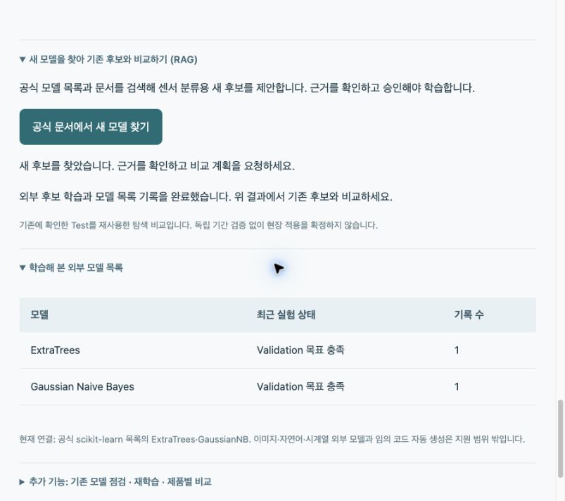
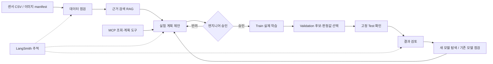

# 반도체 검사 모델 실험 도우미

SKALA 광주 2반 · G045 김용찬 · 과제 2 · 2026-10-22 발표

새 검사 데이터에 맞는 모델을 비교하고 결과에 따라 다음 실험을 제안하는 Agent입니다.

[발표 PPTX](G045_Semiconductor_Agent.pptx) · [발표 PDF](G045_Semiconductor_Agent.pdf) · [5분 대본](발표대본_G045.txt)

원래 Mac에서 측정한 모델 실험 기록을 보존하고, Windows의 테스트·추적 검증을 별도로 남겼습니다.

## 1. 반도체 검사 모델 실험 도우미

AI AGENT MINI PROJECT · 과제 2

데이터를 점검하고, 승인받아 실험하고, 다음 비교를 제안합니다.

SKALA 광주 2반 · G045 김용찬 · 2026.10.22

안녕하세요. SKALA 광주 2반 G045 김용찬입니다. 반도체 검사 데이터를 넣으면 모델을 비교하고, 결과에 따라 다음 실험을 제안하는 Agent를 만들었습니다.

## 2. 데이터가 다르면 비교할 모델도 달라집니다

문제 · 반복 실험을 연결하는 도구가 필요합니다

사용자: 새 검사 데이터로 정상·불량 분류 모델을 만드는 엔지니어

전처리 → 모델 비교 → 근거 정리 → 추가 실험을 매번 반복합니다.

| 데이터 | 교육자료의 모델 예시 | 이번 구현 |
|---|---|---|
| 숫자 센서 | Tree · KNN · SVM · ANN | 여러 분류 모델 실제 학습 |
| 검사 이미지 | ResNet · VGGNet · Autoencoder | 자체 축소 구조 3종 실제 학습 |
| 로그 / 시계열 | BERT·GPT / LSTM·ARIMA | 향후 확장 |

스칼라에서 배운 모델을 바탕으로 반도체 자료에서 참고한 후보도 함께 넣었습니다. 검사 이미지, 로그, 시계열처럼 데이터 형태에 따라 사용하는 모델이 달랐습니다. 이번에는 숫자 센서와 검사 이미지의 정상·불량 분류로 범위를 줄였습니다. 모델 하나를 추천하는 대신, 엔지니어가 반복하는 비교와 기록 과정을 연결하는 것이 목적입니다.

출처·증빙: docs/CURRICULUM_MODELS.md · 반도체 교육 사진의 분류를 표로 재구성

## 3. Agent는 계획과 근거, 엔지니어는 승인을 맡습니다

아키텍처 · 실제 실행 순서

LangGraph로 점검·검색·계획 역할을 연결하고, 승인된 계획만 실행합니다.

목표 미달이면 새 모델 탐색 / 기존 모델 점검으로 이어갑니다.

구조입니다. 데이터 점검, 근거 검색, 실험 계획을 LangGraph로 연결했습니다. 계획과 데이터의 해시를 저장하고 엔지니어가 승인한 뒤에만 학습합니다. 결과 검토에서는 부족한 지표를 보여 주고 새 모델 비교나 기존 모델 점검으로 이어집니다. 학습과 수치는 실험 엔진이 계산하고, LLM은 제한된 근거와 설명을 보조합니다. 자율 Supervisor나 자동 배포까지 구현한 것은 아닙니다.

출처·증빙: app/planner.py · app/workbench.py · app/store.py · mcp_server.py

## 4. ① 데이터를 선택하고 비교 계획을 요청합니다

같은 합성 센서 사례를 끝까지 따라갑니다

제품 A–D · 1,280건 · 불량 201건

A–D는 가상 제품명입니다.

첫 사용: 예제 데이터 준비 → 센서 선택 → 비교 계획 제안받기

한 사례를 끝까지 보겠습니다. 제품 A부터 D의 합성 센서 1,280건을 선택합니다. 불량 정답은 201건이고 제품 이름은 가상입니다. 처음 실행하면 예제 데이터를 준비하고, 센서를 선택한 뒤 비교 계획을 요청합니다.

출처·증빙: app/data.py · docs/evaluation/synthetic_process.json

## 5. ② 전처리·모델·분할을 확인한 뒤 승인합니다

승인 전에는 학습하지 않습니다

Train 768 / Validation 256 / Test 256

같은 생산 묶음(lot)은 구간 사이에 섞지 않습니다.

여러 후보·불균형 설정을 비교한 뒤 상위 후보의 제품 조합 확장

최대 52조건 · 완전탐색은 아닙니다.

Agent가 결측과 불량 비율을 확인하고 전처리와 모델 계획을 제안합니다. 수업 기준 6대2대2를 사전에 고정하고 같은 생산 묶음이 평가에 섞이지 않도록 나눴습니다. 스칼라에서 배운 모델과 반도체 자료에서 참고한 후보를 함께 비교하고 상위 후보의 제품 조합을 확장합니다. 이 계획을 승인해야 실제 학습합니다.

출처·증빙: app/planner.py · app/experiments.py

## 6. ③ Validation으로 후보를 고르고 이유를 남깁니다

Test 결과를 보고 모델 순위를 바꾸지 않습니다

선택 규칙: Recall ≥ 90% · 정상 오판률 ≤ 15% 목표 충족 우선

충족 후보 중 Recall 우선, 동률이면 정상 오판률이 낮은 후보

상위 2모델의 제품 조합 비교 → CatBoost · A+B+C 선택

| 전체 제품 학습 · Validation | Recall | 정상 오판률 | F1 |
|---|---|---|---|
| CatBoost | 100.0% | 9.3% | 80.8% |
| HistGradientBoosting | 100.0% | 10.3% | 79.2% |
| AdaBoost | 97.6% | 6.1% | 85.4% |
| Logistic Regression | 90.5% | 18.7% | 63.3% |

왜 CatBoost를 골랐는지입니다. 먼저 Validation에서 두 목표를 충족했는지 확인하고 Recall을 우선합니다. 동률이면 정상 오판률이 낮은 후보가 앞섭니다. AdaBoost는 F1이 더 높지만 Recall 우선 규칙에서는 CatBoost가 앞섰습니다. 이후 상위 두 알고리즘의 제품 조합을 비교해 A B C로 학습한 CatBoost를 골랐습니다. 이 규칙은 실험 전에 정한 교육용 목표입니다.

출처·증빙: docs/evaluation/synthetic_process.json · app/metrics.py:selection_key

## 7. ④ 더 찾았지만, 목표에는 못 미쳤습니다

같은 Test 256건 · 불량 32건 / 정상 224건

기본: Logistic Regression / 선택 후보: CatBoost · A+B+C

후보 Recall 84.4% < 목표 90% → 추가 실험 필요

| 같은 Test에서 비교 | 기본 모델 | 선택 후보 |
|---|---|---|
| 불량 발견 | 20 / 32개 | 27 / 32개 |
| 놓친 불량 | 12개 | 5개 |
| 정상 오판 | 1 / 224개 | 14 / 224개 |
| Recall | 62.5% | 84.4% |

마지막 Test입니다. 같은 불량 32개 중 기본 Logistic은 20개, 후보 CatBoost는 27개를 찾았습니다. 대신 정상을 불량으로 오판한 수는 1개에서 14개로 늘었습니다. 후보 Recall 84.4%는 목표 90퍼센트에 못 미쳤습니다. 선택 후보와 현장 적용 확정은 다른 단계이며, 이 결과를 보고 다음 실험으로 이어갑니다.

출처·증빙: docs/evaluation/synthetic_process.json

## 8. ⑤ 공식 문서에서 새 후보를 찾아 다시 비교합니다

다음 실험 · 모델 탐색 RAG

공식 모델 목록·문서 조회 → 근거 검색 → 새 비교 계획 → 승인·학습

ExtraTrees · GaussianNB를 기존 후보와 비교하고 목록을 갱신

기록된 추가 실험에서는 CatBoost 유지

현재는 검토된 두 adapter 범위 · 임의 코드 자동 실행은 미구현

다음 행동은 새 모델 비교입니다. 공식 모델 목록과 문서를 조회하고, RAG로 근거를 연결해 ExtraTrees와 Gaussian Naive Bayes를 제안합니다. 승인받아 기존 후보와 같은 조건으로 학습하고 후보 목록에 기록했습니다. 이 추가 실험에서는 CatBoost를 유지했습니다. 현재는 검토된 두 모델 연결을 지원합니다. 기존 Test를 재사용한 탐색 비교여서 최종 적용에는 새로운 독립 데이터가 필요합니다.

출처·증빙: app/discovery.py · docs/evaluation/model_discovery.json

## 9. 실험 경로와 실패 상태를 기록합니다

적용 기술 · 관측 가능성 및 평가

LangGraph 역할 분리 · MCP 4도구와 지식 Resource · 의존성 주입

RAG: 교육 근거 14개 + 공식 외부 문서 검색

LangSmith APAC: 실제 계획 생성과 하위 실행 API 재조회 성공

30개 테스트 통과 · LLM 응답 실패/미사용은 규칙 설명으로 표시

기술은 LangGraph 역할 분리, MCP 네 도구와 지식 리소스, RAG와 의존성 주입을 적용했습니다. LangSmith에는 이 노트북에서 실제 계획 생성과 하위 실행 기록을 보내고 다시 조회했습니다. 다만 이 노트북의 현재 모드는 로컬 LLM 미사용입니다. 기존 노트북의 LLM 실행 기록과 구분하고, 응답 실패는 규칙 설명으로 표시합니다. LLM-as-a-Judge는 미구현입니다.

출처·증빙: docs/evaluation/langsmith_check.json · docs/evaluation/agent_integration.json · docs/evaluation/tests-windows.txt

## 10. 성과는 모델 이름보다, 다음 판단까지 연결한 흐름입니다

교훈 · 트레이드오프 · 다음 개선

구현: 데이터 점검 → 계획 승인 → 실제 비교 → 다음 실험 제안

교훈: Recall을 높이면 정상 오판도 늘 수 있고, 선택 규칙이 결론을 바꿉니다.

한계: 합성 데이터·작은 불량 표본·반복 Validation·Test 재사용 탐색

다음: 현장 기준 합의 → 독립 기간 검증 → 엔지니어 작업시간 측정

핵심 성과는 가장 좋은 모델 이름을 말하는 것보다, 계획 승인부터 비교 결과와 다음 실험까지 연결했다는 점입니다. Recall을 높이면 정상 오판이 늘 수 있고, 선택 기준이 결과를 바꾼다는 것을 배웠습니다. 합성 데이터와 작은 표본, 반복 비교가 한계입니다. 다음에는 현장 기준과 독립 기간 데이터로 검증하고 실제 작업시간 절감도 측정하겠습니다. 감사합니다.

## 11. 모델별 Validation 비교

부록 · 알고리즘마다 최선 불균형 설정 1개 표시

같은 전체 제품 Train에서 비교했습니다. 이 표는 제품 조합 확장 전 단계입니다.

후보별 판정값은 Validation에서 조정했습니다. Test 전체 모델 순위가 아닙니다.

| 모델 · 전체 제품 학습 | 불균형 설정 | Recall | 정상 오판률 | F1 |
|---|---|---|---|---|
| CatBoost | none | 100.0% | 9.3% | 80.8% |
| HistGradientBoosting | none | 100.0% | 10.3% | 79.2% |
| LightGBM | none | 100.0% | 10.7% | 78.5% |
| XGBoost | none | 100.0% | 11.2% | 77.8% |
| Random Forest | none | 100.0% | 13.1% | 75.0% |
| AdaBoost | none | 97.6% | 6.1% | 85.4% |
| SVM (RBF) | weighted | 97.6% | 10.7% | 77.4% |
| Gradient Boosting | none | 97.6% | 11.7% | 75.9% |
| MLP / ANN | none | 97.6% | 14.5% | 71.9% |
| Decision Tree | none | 92.9% | 8.4% | 78.8% |
| KNN | none | 92.9% | 11.2% | 74.3% |
| Logistic Regression | weighted | 90.5% | 18.7% | 63.3% |

전체 제품 학습 24조건에서 모델마다 최선 불균형 설정을 하나씩 표시합니다. CatBoost와 HistGradientBoosting의 제품 조합을 확장해 최종 CatBoost A+B+C를 선택했습니다. 모든 후보가 두 목표를 못 맞추면 목표 부족분 합계가 적은 탐색 참고 후보를 보여 줍니다.

출처·증빙: docs/evaluation/synthetic_process.json

## 12. 데이터를 바꾸면 후보와 결론도 달라집니다

부록 · 각 행 안에서만 같은 Test 비교

합성 센서·이미지는 실제 공장 데이터가 아닙니다. SECOM은 실제 공개 센서 자료입니다.

각 데이터의 Test는 서로 다릅니다. 모델의 종합 순위로 해석하지 않습니다.

| 데이터 | 기본 / 선택·참고 후보 | 불량 발견 | 정상 오판 | 판단 |
|---|---|---|---|---|
| 합성 센서 | Logistic / CatBoost | 20 → 27 / 32 | 1 → 14 / 224 | 추가 실험 필요 |
| UCI SECOM | Logistic / XGBoost | 0 → 5 / 23 | 17 → 87 / 357 | 목표 충족 후보 없음 |
| 합성 이미지 | 축소 ResNet / Autoencoder | 15 → 14 / 15 | 32 → 0 / 105 | 불량 표본 보강 |

SECOM은 1,567건 중 불합격104건이고 제조사·제품ID는 제공되지 않습니다. 이미지 Test의 불량15건은 작은 표본이어서 목표 통과를 확정하기 어렵습니다.

출처·증빙: https://archive.ics.uci.edu/dataset/179/secom · https://doi.org/10.24432/C54305 · docs/evaluation/summary.json

## 13. 3σ는 변화 감지, Recall 목표는 판정 성능입니다

부록 · 재학습 판단과 기존 모델 관리

3σ: 공정 값·오차가 평소와 다른가? 안정성·분포·관리도 가정을 먼저 확인

Recall/FPR: 정답이 있는 새 데이터에서 검사 모델이 목표를 만족하는가?

현재 구현은 교육용 Recall 90%·정상 오판 15% 점검 · 3σ 트리거 미구현

새 합성 배치의 동일 Test: 불량 발견 43 → 153 / 167개

정상 오판 96 → 79개 · 승인 후 같은 알고리즘 재학습

정답이 없으면 Recall을 직접 계산할 수 없습니다. 향후 드리프트 감지를 검토할 수 있지만 변화 감지만으로 재학습 효과를 확정하지 않습니다. 현재는 새 정답 데이터의 Train 구간으로 점검하고 승인 후 후보를 비교합니다. 운영 모델을 자동 교체하지 않습니다.

출처·증빙: app/monitoring.py · docs/evaluation/model_management.json

## 14. 6:2:2는 사전 고정, 혼합 비율은 별도 실험입니다

부록 · 데이터 분할과 앙상블

Train: 모델 학습 / Validation: 모델·제품 조합·판정값 선택 / Test: 선택 결과 확인

합성 센서 768 / 256 / 256 · 후보 A+B+C는 Train 중 544건 학습

SECOM은 날짜 블록 60/20/20 → 실제 행 수 820 / 367 / 380

RF·부스팅은 사용 · 서로 다른 모델의 혼합 가중치 탐색은 미구현

확장 시: 사전에 정한 가중치를 Validation으로 고르고 새 Test로 확인

6대2대2가 모든 데이터의 최적 비율이라는 뜻은 아닙니다. 수업 기준으로 정한 재현 가능한 실험 조건입니다. 같은 lot·날짜 경계를 지키므로 실제 행 비율은 달라집니다. 추가 탐색으로 기존 Test를 반복 확인했다면 독립 기간 Test를 새로 확보해야 합니다.

출처·증빙: app/data.py · docs/MODEL_DISCOVERY_DESIGN.md

## 15. 구현한 기술과 남은 범위를 구분합니다

부록 · 최종 보고서 기술 대응표

과제의 기술 목록 전체를 구현했다고 주장하지 않습니다.

| 요소 | 구현·증빙 | 현재 한계 |
|---|---|---|
| Multi-Agent / LangGraph | 점검·검색·계획·결과 검토 역할 | 고정 그래프 · 자율 Supervisor 미구현 |
| RAG | TF-IDF / 선택적 Qwen 임베딩·cosine | 별도 Vector DB 미도입 · 14개 소규모 근거 |
| 외부 모델 탐색 | 공식 문서 검색·ExtraTrees/GaussianNB | 검토된 두 adapter만 지원 |
| MCP | stdio 4도구 + 지식 Resource | 승인·학습 실행은 API에서만 |
| 코드 품질 | 모듈화·DI·단위/API 테스트 | 배포·동시 다중 사용자 미검증 |
| LangSmith | 실제 root/child trace API 재조회 | LLM 응답 성공과 별도 |
| LLM-as-a-Judge | 미구현 | 허용 코드·출처 검사를 대신 사용 |

기존 dense/TF-IDF 검색 평가는 고정13질의에서 Hit@3 양쪽100%, MRR@3 양쪽0.9615였습니다. 일반적인 검색 성능 우위를 주장하지 않습니다. LLM을 꺼도 규칙 실험 모드는 동작하며 실행 상태를 UI와 보고서에 표시합니다.

출처·증빙: docs/ASSIGNMENT_CHECKLIST.md · docs/evaluation/agent_integration.json

## 16. 출처와 재현 자료

부록 · 질문 대비와 제출 링크

모델 참고: 스칼라 9주차 수업 + 15주차 반도체 발표자료

SECOM: McCann & Johnston (2008), UCI · DOI 10.24432/C54305 · CC BY 4.0

측정 원본: docs/evaluation/ · 고정 seed 45 · 기존 Mac 결과와 Windows 검증 구분

소스·최종 보고서: github.com/dragonchan95/Semiconductor-AI-Agent

기존 Google Slides 주소는 README에 보존 · 온라인 갱신 여부는 별도 확인

발표는 1~10장이고 11~16장은 질문용입니다. 회사 공통 Recall 수치나 수율·금액 이익, 시간 절감은 확인하지 않았습니다. 제출 명단 엑셀과 교육자료 원본, API 키는 공개 저장소에 포함하지 않습니다.

출처·증빙: https://github.com/dragonchan95/Semiconductor-AI-Agent · https://docs.google.com/presentation/d/1J2m_cpXyvb-5_Xabs2DsD3EnEV6B6GicF5OP2s5FohU/edit · docs/CURRICULUM_MODELS.md

## 아키텍처 흐름도

승인은 SQLite에 저장한 계획 hash와 데이터 hash로 검증합니다. LangGraph interrupt를 사용한 구현은 아닙니다.
외부 모델 탐색 후 승인과 실행은 API에서 처리합니다. 운영 모델 자동 교체는 하지 않습니다.

## 수행하며 배운 점

LLM 설명과 실험의 수치·실행 권한을 분리해야 잘못된 수치나 무승인 학습을 막을 수 있었습니다.
목표와 분할을 사전에 정하지 않으면 높은 F1, 높은 Recall 중 어떤 결론을 택할지 임의로 바뀝니다.
Mac에서 통과하던 SQLite 코드도 Windows에서는 연결이 닫히지 않아 파일을 잠글 수 있었습니다.
환경 이동에서는 소스 코드뿐 아니라 설정, 모델 설치 여부, 실행 이력을 구분해 복원해야 합니다.

## 한계와 후속 평가

단일 seed·동일 Validation의 반복 선택·작은 불량 표본이 한계입니다.
새 모델 탐색에 이미 확인한 Test를 재사용했으므로 독립 기간의 새 Test가 필요합니다.
전처리·모델·판정값·학습 제품 범위가 함께 바뀐 비교이며 특정 기법의 인과 효과가 아닙니다.
수율, 금액 이익, 작업시간 절감, 양산 효과는 측정하지 않았습니다.
회사 공통 Recall/FPR 숫자를 가정하지 않고 현장 담당자가 목적과 비용에 맞춰 정해야 합니다.
LLM-as-a-Judge·별도 Vector DB·자율 Supervisor·3σ 재학습 트리거·혼합 가중치 탐색은 미구현입니다.
