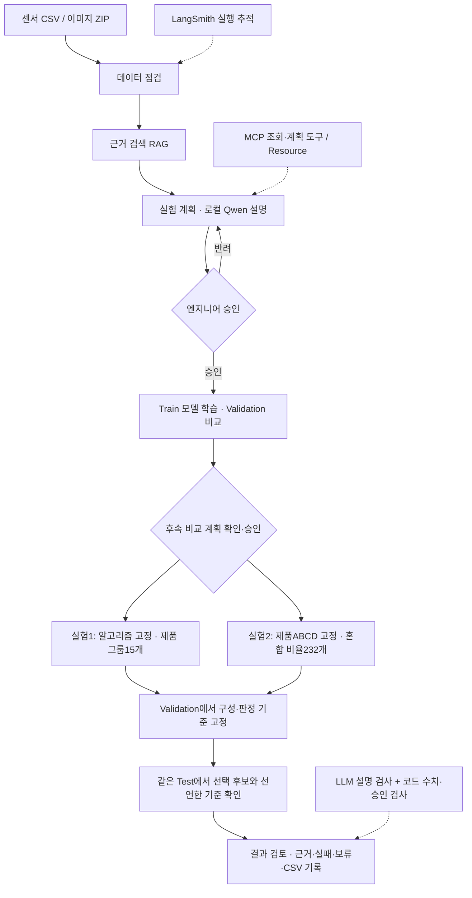
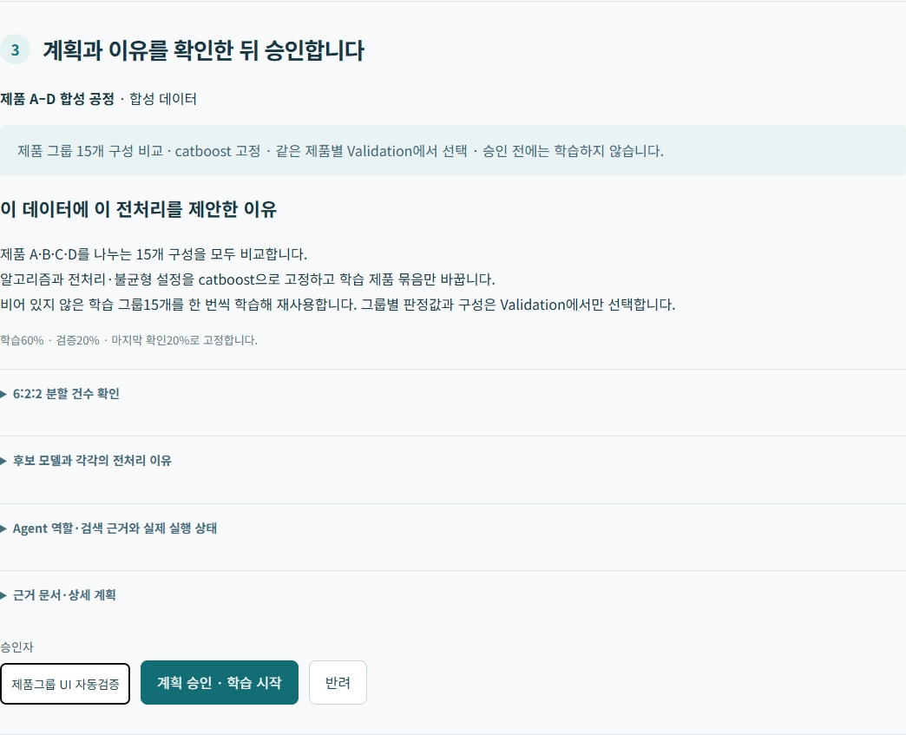
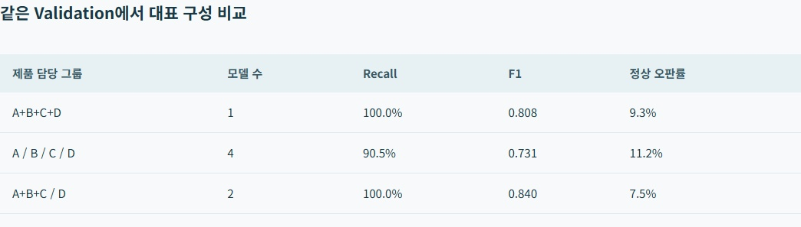
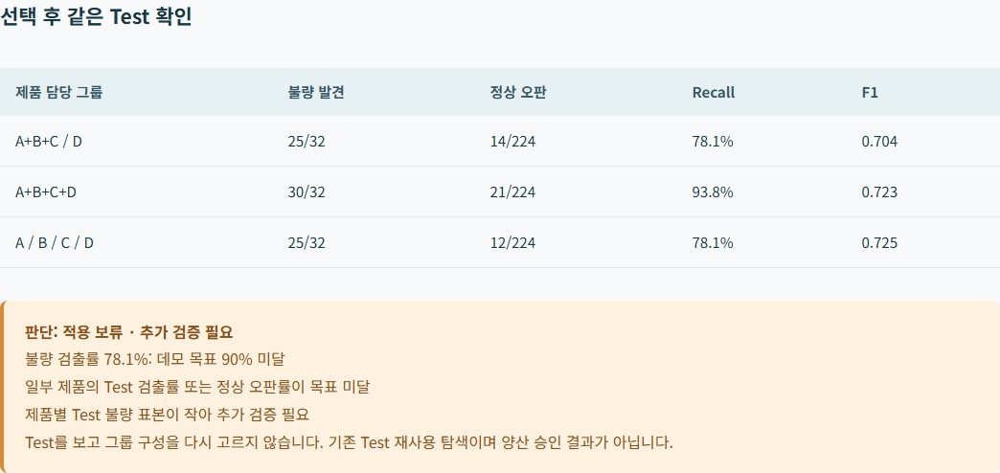

# 반도체 검사 모델 실험 도우미 — 최종 보고서

## 1. 표지 및 소속 정보

**SKALA 광주 2반 · G045 김용찬 · AI Agent 신규 구현 과제2 · 2026-10-22**

검사 데이터를 점검하고, 학습할 제품 묶음과 모델 예측의 혼합 비율을 비교한 뒤 선택 이유와 검증 결과를 보여 주는 Agent입니다.

[소스 코드](https://github.com/dragonchan95/Semiconductor-AI-Agent) · [발표 PPTX](G045_Semiconductor_Agent.pptx) · [발표 PDF](G045_Semiconductor_Agent.pdf) · [5분 대본](발표대본_G045.txt)

이 문서는 최신 공개 보고서입니다. 기존 Google Slides 원본은 최신 PPTX 반영이 아직 필요합니다. [공개 접근 확인 기록](evaluation/public_links.json)을 별도로 보관합니다. 발표는 본문1~10장, 11~14장은 질문용 부록입니다.

## 2. 문제 개선 및 신규 구현 사항

### 해결할 문제

이 신규 구현 프로젝트에서 설정한 기존 업무 방식은 **엔지니어가 검사 데이터의 학습 제품 범위·모델·혼합 비율을 직접 비교하고, 선택 근거와 결과를 정리해야 하는 상황**입니다. 비교 계획·승인·실행·기록을 연결해 그 선택을 돕는 것을 해결 과제로 정했습니다. 특정 회사의 기존 시스템을 조사하거나 업무시간·기존 성능을 실측한 프로젝트는 아닙니다.

| 개선 대상 | 신규 구현 | 확인 방법 |
|---|---|---|
| 반복적인 데이터·전처리 확인 | 결측·불균형·생산 묶음 점검과 근거 제시 | 데이터·계획 화면 |
| 학습할 제품 범위 선택 | ABCD 하나, ABC와D, AB와CD, 각각4개 등15개 그룹 구성 비교 | 같은 Validation의 구성별·제품별 점수 |
| 모델 예측을 섞을 비율 선택 | 단일·균등·5% 간격을 포함한232개 비율 비교 | 비율별 Recall·F1·정상 오판률과 CSV |
| 근거 없이 학습·선택 | 계획·데이터 hash를 확인한 단회 승인 후 실행 | 미승인·중복 승인 차단 |
| 높은 점수만 보고 적용 | 선택 후 Test 확인 및 목표 미달·표본 부족 시 보류 | 그룹 실험의 실제 보류 결과 |
| 비교 후보를 추가하기 위한 문서 탐색 | 공식 문서 검색과 근거 연결 RAG | ExtraTrees·GaussianNB 후보·출처 화면 |

모델·제품 그룹·앙상블 비율을 한 번에 공동 전역 최적화했다고 주장하지 않습니다. **알고리즘을 고정한 제품 그룹 실험**과 **학습 제품ABCD를 고정한 앙상블 실험**을 각각 수행했습니다.

## 3. 적용 기술 요소

| 요소 | 실제 구현·증빙 | 현재 범위 |
|---|---|---|
| Multi-Agent & LangGraph | [planner.py](../app/planner.py): 점검·검색·계획 역할. [advisors.py](../app/advisors.py): 로컬 Qwen 역할별 응답·근거 코드 검사. 결과 검토는 실행 후 호출 | 고정 역할 그래프. 자율 Supervisor·동적 재계획은 미구현 |
| MCP | [mcp_server.py](../mcp_server.py): list_datasets, propose_experiment, get_experiment_result, explain_model_candidates와 semiconductor://knowledge/{topic} Resource | stdio4도구와 Resource 구현. 별도 MCP Prompt는 미사용. 승인·학습 실행은 API에서 처리 |
| RAG | 5주차 BGE-M3·FAISS 실습 응용. 내부 교육 근거14개와 공식 모델 문서의 의미 임베딩·검색·로컬 Qwen 문맥 주입. [retrieval.py](../app/retrieval.py), [실제 검증](evaluation/vector_rag.json) | FAISS IndexFlatIP와 출처 JSON을 로컬 저장. 별도 서버형 Vector DB는 아님. 실패 시TF-IDF 대체 상태 표시 |
| 아키텍처·코드 품질 | 데이터·학습·그룹·앙상블·저장·API 모듈 분리. Workbench와 Dependencies에 Store·Knowledge·Advisor 주입 | [단위/API 테스트](evaluation/tests-windows.txt) 51개 통과. 승인·분할·지표·저장 모델 재현·라우팅 검증 포함 |
| LangSmith | [실행 기록](evaluation/langsmith_check.json): 실제 계획 생성과 하위 실행을 APAC에 전송하고 API 재조회 | 공개·합성 자료로 검증. 로컬 추론과 외부 추적은 별개이며 모든 후속 실험을 추적했다고 주장하지 않음 |
| LLM-as-a-Judge | [judge.py](../app/judge.py): 실제 실험 기록과 설명 문장을 로컬 Qwen에 주어 맞는 설명인지 검사 | 직접 만든 예제 8개 중 6개 올바른 판단, 2개 오판. 보완에 사용한 개발 예제이며 독립 평가 아님 |
| 기타 적용 | 실제 분류 모델·제품별 라우팅·확률 혼합·계획 hash·lot/날짜 분할·실험 CSV·로컬 Qwen2.5 | 회사 공통 기준·양산 수율 효과·자동 배포는 검증하지 않음 |

벡터 검색은 수업과 같은 BGE-M3·FAISS 구조로 구현했습니다. 다중 사용자 서버형 Vector DB나 자율 Supervisor까지 구현한 것은 아닙니다. 적용 기술의 실제 범위를 위 표와 같이 구분합니다. [전체 과제 대응표](ASSIGNMENT_CHECKLIST.md), [평가 방법](EVALUATION.md), [RAG 상세](RAG.md)

## 4. 구현 결과

### 아키텍처 흐름도

승인은 저장된 계획 hash·데이터 버전과 단회 실행 상태로 확인합니다. LangGraph interrupt를 사용한 구현은 아닙니다. 제품 그룹 실험과 비율 실험은 별도 승인된 비교이며 자동 운영 모델 교체는 수행하지 않습니다.

### 시연 시나리오와 화면

제품 A–D 합성 센서1,280건(불량201건)을 선택합니다. 생산 묶음을 섞지 않고 Train768 / Validation256 / Test256으로 나눕니다. 원본 행·라벨·분할을 고정한 뒤 두 실험을 각각 진행합니다.

1. 데이터를 선택하고 점검·근거·비교 계획을 확인합니다.
2. 계획을 승인해 실제 학습합니다. 후속 그룹·비율 계획도 별도로 승인합니다.
3. Validation에서 선택한 구성·비율·판정 기준을 고정합니다.
4. Test에서 목표와 표본을 확인하고, 실패하면 적용 보류를 표시합니다.
5. 전체 후보 점수와 선택 근거를 JSON·CSV로 확인합니다.

### 실험1: 어떤 제품을 함께 학습할까요?

CatBoost 알고리즘과 설정을 고정해15개 담당 그룹 구성을 모두 비교합니다. 비어 있지 않은 학습 묶음15개를 한 번씩 적합해 재사용합니다. 각 구성은 전체 제품을 중복·누락 없이 담당하며 같은 Validation 행에서 비교합니다. 제품별 정상 오판 한도와 검출 목표를 확인한 뒤 전체 Recall·F1, 동률이면 모델 수를 고려합니다.

| 구성 | 모델 수 | Validation Recall | Validation F1 | Test Recall | Test F1 |
|---|---|---|---|---|---|
| A+B+C+D | 1 | 100.0% | 0.808 | 93.8% | 0.723 |
| A+B+C / D | 2 | 100.0% | 0.840 | 78.1% | 0.704 |
| A / B / C / D | 4 | 90.5% | 0.731 | 78.1% | 0.725 |

Validation 선택은 **A+B+C / D**입니다. 하지만 Test Recall **78.1%**로 목표90% 미달이며 제품별 표본도 작아 **적용 보류**를 표시했습니다. Test에서 공통 모델 점수가 더 높았다고 선택 구성을 다시 바꾸지 않았습니다. 실패 결과도 보존했습니다.

[전체15개 구성 원본](evaluation/product_partitions.json) · [실제 UI·승인·CSV 검증](evaluation/grouping_browser.json) · [방법과 한계](PRODUCT_GROUPING.md)

### 실험2: 예측을 어떤 비율로 섞을까요?

학습 제품ABCD를 고정하고 CatBoost·HistGradientBoosting·LightGBM을 구성 후보로 사용합니다. 합계100% 비율을5% 간격으로 모두 비교하고 균등 비율도 포함했습니다. 단일 모델도 포함하며 성능이 같으면 적은 모델을 사용합니다. **정상 오판 한도 안에서 Recall 최대 → 동률 F1** 순서로 비율과 판정 기준을 Validation에서 고릅니다.

| Validation 비교 | Recall | 정상 오판률 | F1 |
|---|---|---|---|
| 최선 단일 | 100.0% | 9.3% | 0.808 |
| 균등 혼합 | 100.0% | 10.3% | 0.792 |
| 선택90:0:10 | 100.0% | 8.9% | 0.816 |

| 선택 후 같은 Test | 최선 단일 CatBoost | 선택 CatBoost90%+LightGBM10% |
|---|---|---|
| 불량 발견 | 30/32 | 30/32 |
| 정상 오판 | 21/224 | 19/224 |
| Recall | 93.8% | 93.8% |
| F1 | 0.723 | 0.741 |

선택 비율은 **CatBoost90% + LightGBM10%**이며 HistGradientBoosting은0%입니다. 승인한 후보·간격·Validation 범위 안의 최선입니다. 전체 알고리즘과 모든 연속 비율의 전역 최적을 뜻하지 않습니다.

[실제232개 비율 원본](evaluation/weighted_ensemble.json) · [실제 UI·승인·CSV 검증](evaluation/ensemble_browser.json) · [앙상블 방법](ENSEMBLE.md)

### 근거 검색과 설명 검사

외부 모델 탐색에도 RAG를 사용합니다. **공식 모델 문서 수집 → BGE-M3 의미 임베딩 → FAISS 검색 → 검색 근거를 로컬 Qwen에 전달 → 후보 제안 → 엔지니어 승인 후 비교** 순서입니다. 정규화한 벡터는 FAISS IndexFlatIP에, 출처·문서 내용은 JSON에 저장하고 문서나 설정이 바뀌면 다른 인덱스를 만듭니다. 수업은 SentenceTransformer로 실행했고 현재 Windows는 같은 BGE-M3 계열을 Ollama로 로컬 실행합니다. 학습 연결은 사전 검토된 ExtraTrees·GaussianNB 두 후보입니다. 문서 검색이 임의 모델의 자동 설치나 성능 우위 확인을 뜻하지는 않습니다.

LLM-as-a-Judge는 실제 결과와 설명을 함께 보고 맞는 설명인지 검사합니다. 이전 실험의 실제27개 발견을30개라고 바꾼 오류를 놓친 사례도 있습니다. 정답 여부8개 중6개 판단 일치는 설명 검사 예제의 결과이며 분류 모델 정확도가 아닙니다. 원래 실패 기록과 기준 실험을 보존합니다. [평가 원본](evaluation/llm_judge.json)

## 5. 교훈

### 한계와 트레이드오프

- 제품별로 나누면 제품 특성을 반영할 수 있지만 학습 데이터·불량 표본은 줄고 관리할 모델 수는 늘어납니다.
- 전체 점수로 제품별 실패를 숨기지 않도록 제품별 정상 오판률·검출률·표본을 함께 확인했습니다.
- 그룹 실험은 Validation에서 좋았지만 Test에서 실패했습니다. 선택 근거와 적용 가능성은 별도로 판단해야 합니다.
- 합성 데이터, 단일 seed, 작은 제품별 불량 표본, 같은 Validation의 반복 선택이 한계입니다. 기존 프로젝트에서 이미 확인한 Test를 추가 탐색에 재사용했으므로 독립적인 최종 검증 실적이 아닙니다.
- 그룹·알고리즘·앙상블 비율의 공동 전역 최적화, 회사 공통 합격 기준, 수율·금액 이익·작업시간 절감·자동 배포는 검증하지 않았습니다.
- LLM 설명 검사도 오판합니다. RAG는 BGE-M3·FAISS 로컬 벡터 저장·검색이며 별도 서버형 DB·자율 Supervisor를 구현했다고 주장하지 않습니다. 작은 고정 검색 질문은 독립적인 일반 검색 평가가 아닙니다.

### 향후 개선

현장 담당자와 미검출·오판 비용 및 허용 범위를 먼저 합의합니다. 새 독립 기간·생산 묶음으로 검증하고 반복 분할·교차검증과 제품별 불확실성을 평가합니다. 그 뒤 필요하면 중첩 검증으로 그룹·모델·비율 탐색을 확장하고, 문서 규모와 동시 사용자가 늘면 서버형 Vector DB를 평가합니다. 실제 엔지니어의 작업시간도 측정합니다.

### 수행 소감과 배운 점

높은 점수 하나를 보여 주기보다 무엇을 고정하고 무엇을 비교했는지를 명확히 해야 선택을 설명할 수 있었습니다. 제품별 전용 모델과 앙상블이 항상 더 좋은 것은 아니었습니다. LLM의 설명과 코드가 계산한 숫자·승인 권한을 분리하고, 실패·보류를 기록하는 것이 중요했습니다. 환경 이동 과정에서는 모델·설정·실험 이력의 복원과 Windows SQLite 연결 종료도 확인해야 했습니다.

참고: [교육자료·모델 출처](CURRICULUM_MODELS.md), [전체 평가 방법](EVALUATION.md), [실험 원본](evaluation/), [데이터 출처 UCI SECOM](https://archive.ics.uci.edu/dataset/179/secom), [soft voting 공식 설명](https://scikit-learn.org/stable/modules/ensemble.html#voting-classifier).
