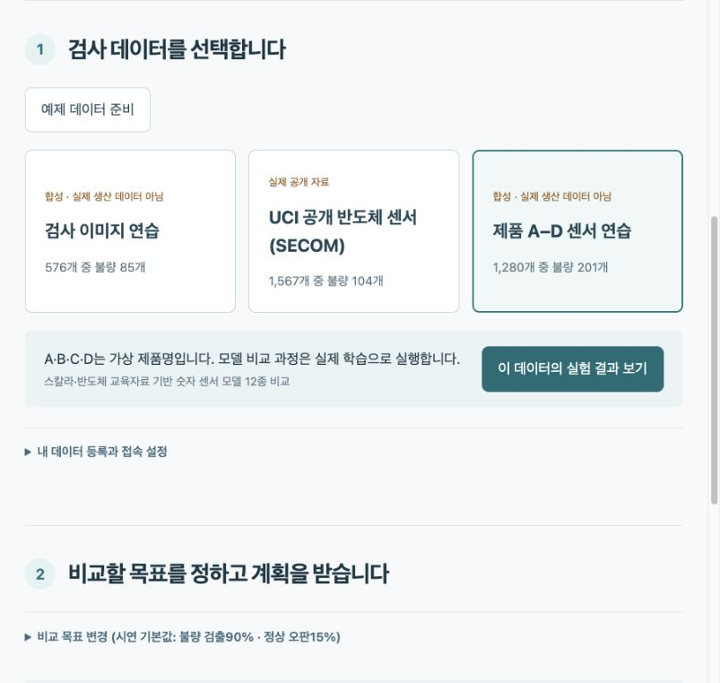
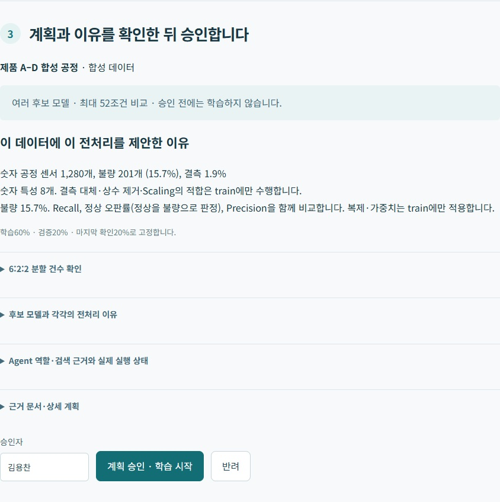
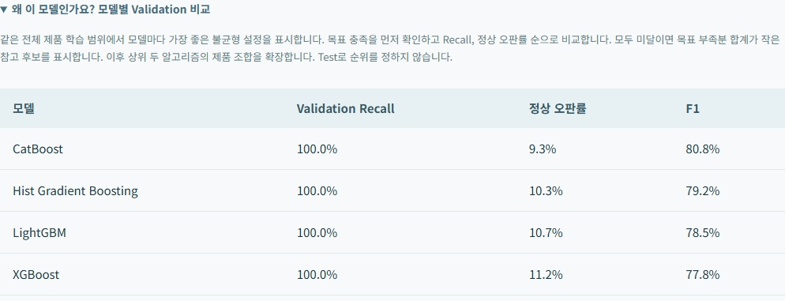
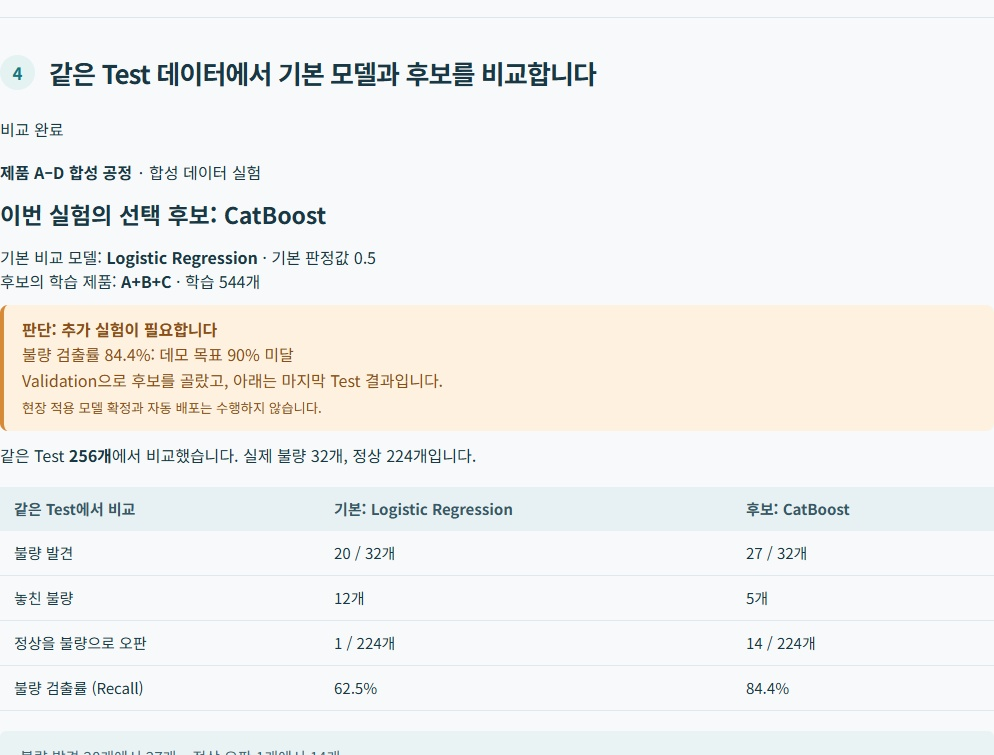
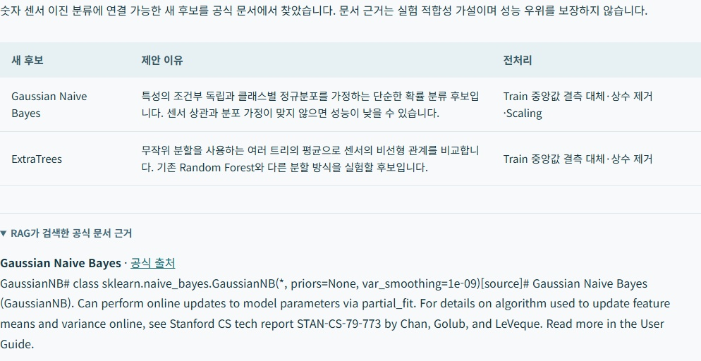
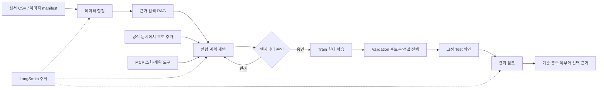

# 반도체 검사 모델 실험 도우미

SKALA 광주 2반 · G045 김용찬 · 과제 2 · 2026-10-22 발표

검사 데이터에 맞는 모델을 비교하고 선택 근거와 판정 성능을 보여 주는 Agent입니다.

[발표 PPTX](G045_Semiconductor_Agent.pptx) · [발표 PDF](G045_Semiconductor_Agent.pdf) · [5분 대본](발표대본_G045.txt)

원래 Mac의 실험 기록을 보존했으며 Windows 재실행에서도 합성 센서 Test 결과를 동일하게 재현했습니다. 로컬 LLM·테스트·추적 검증은 별도 기록으로 남겼습니다.

## 1. 반도체 검사 모델 실험 도우미

01 · 무엇을 만드는 프로젝트인가요?

검사 데이터를 넣으면, 비교 계획과 모델 선택 근거를 보여 주는 Agent

SKALA 광주 2반 · G045 김용찬 · 2026.10.22

안녕하세요. 김용찬입니다. 검사 데이터를 넣으면 모델 비교 계획을 세우고, 승인 후 실제로 학습해서 선택 이유와 결과를 보여 주는 Agent를 만들었습니다.

## 2. 반복하던 모델 비교와 기록을 한 흐름으로

02 · 사용자와 해결할 문제

사용자: 새 검사 데이터로 정상·불량 분류 모델을 만드는 엔지니어

반복 업무: 데이터 확인 → 전처리 선택 → 여러 모델 학습 → 비교·기록

구현: Agent가 근거와 계획을 제시하고, 엔지니어가 승인하면 실행

오늘은 숫자 센서 사례 하나로 입력부터 결과까지 보여 드립니다.

대상은 검사 모델을 만드는 엔지니어입니다. 데이터가 바뀔 때마다 전처리와 모델을 비교하고 이유를 기록해야 합니다. 이 반복 작업을 하나로 연결했습니다. 스칼라에서 배운 모델과 반도체 자료의 후보를 함께 넣었고, 오늘은 센서 사례 하나를 따라가겠습니다.

## 3. 비교 전에, 좋은 모델의 기준부터 정합니다

03 · 결과를 읽기 위한 두 가지 지표

불량 검출률(Recall): 실제 불량 중 찾아낸 비율

정상 오판률: 정상을 불량으로 잘못 판정한 비율

이번 목표: 불량 100개 중 90개 이상 발견 · 정상 100개 중 오판 15개 이하

두 목표 충족 → 검출률이 높은 후보 → 동률이면 정상 오판이 적은 후보

90%·15%는 교육용 목표입니다. 실제 허용 범위는 현장 담당자와 정합니다.

먼저 비교 기준입니다. 불량 검출률은 실제 불량 중 찾아낸 비율이고, 정상 오판률은 정상을 불량으로 잘못 본 비율입니다. 불량을 많이 찾는 것과 정상 오판을 줄이는 것을 함께 봐야 합니다. 이번에는 교육용 목표를 먼저 정하고, 목표를 충족한 후보 중 검출률을 우선하도록 했습니다.

출처·증빙: app/metrics.py · docs/evaluation/synthetic_process.json

## 4. ① 검사 데이터를 선택합니다

04 · 실제 화면 | 이번 시연의 입력

합성 센서 1,280건 · 불량 201건 · 제품 A–D는 가상 이름

센서 CSV와 검사 이미지 ZIP 등록도 지원합니다.

오늘은 센서 예제의 입력부터 결과까지 설명합니다.

실제 앱 화면입니다. 제품 A부터 D의 합성 센서 천이백팔십 건을 선택합니다. 이 중 불량 정답은 이백한 건입니다. 직접 만든 예제로, 실제 공장 데이터는 아닙니다. 내 센서 CSV나 검사 이미지 ZIP을 등록하는 기능도 있습니다.

출처·증빙: app/data.py · docs/assets/app-data.jpg

## 5. ② 점검 결과와 비교 계획을 확인하고 승인합니다

05 · 실제 화면 | 승인 전에는 학습하지 않습니다

결측·불균형 점검과
전처리 이유 확인

학습 60% / 후보 선택 20% / 마지막 확인 20% · 같은 lot은 분리

여러 모델·불균형 설정·제품 조합을 최대 52조건 비교

엔지니어의 승인 후 실제 학습 시작

계획을 요청하면 데이터 점검과 전처리 이유가 나옵니다. 학습, 후보 선택, 마지막 확인 데이터를 육 대 이 대 이로 나누고, 같은 생산 묶음은 섞지 않습니다. 여러 모델과 제품 조합의 비교 범위를 확인한 다음 엔지니어가 승인해야 실제 학습을 시작합니다.

출처·증빙: app/planner.py · app/workbench.py · docs/assets/app-plan.jpg

## 6. ③ 후보 선택용 데이터로 모델을 비교합니다

06 · 실제 화면 | Validation = 후보 선택용 데이터

학습에 쓰지 않은 Validation에서 같은 기준으로 비교합니다.

앱 비교표 상단 4개 후보를 표시했습니다. 전체표는 부록에 있습니다.

선택: CatBoost → 상위 후보의 학습 제품 조합도 비교 → A+B+C

마지막 확인용 Test 결과로 후보 순위를 바꾸지 않습니다.

학습이 끝나면 후보 선택용 데이터인 Validation에서 비교합니다. 화면처럼 검출률과 정상 오판률을 나란히 보여 줍니다. 같은 검출률에서는 정상 오판이 적은 CatBoost가 앞섰습니다. 상위 후보의 학습 제품 조합도 비교해 최종적으로 A B C로 학습한 CatBoost를 골랐습니다. 마지막 확인용 Test로 순위를 바꾸지는 않습니다.

출처·증빙: docs/evaluation/synthetic_process.json · docs/evaluation/presentation_screenshots.json

## 7. ④ 마지막 확인: 더 찾았지만, 오판도 늘었습니다

07 · 실제 화면 | 같은 Test 256건: 불량32개 · 정상224개

불량 발견 20 → 27개

정상 오판 1 → 14개

후보 검출률 84.4% < 목표 90%

화면의 결론: 추가 검증 필요 · 현장 적용 확정은 보류

이제 남겨 둔 Test에서 기본 Logistic과 선택 후보를 비교합니다. 불량 서른두 개 중 발견은 스무 개에서 스물일곱 개로 늘었습니다. 대신 정상 오판도 한 개에서 열네 개로 늘었습니다. 후보 검출률 팔십사 점 사 퍼센트는 목표 구십 퍼센트에 못 미칩니다. 그래서 최고 모델이라고 끝내지 않고, 추가 검증이 필요하다는 판단까지 보여 줍니다.

출처·증빙: docs/evaluation/windows_llm_synthetic.json · docs/evaluation/presentation_screenshots.json

## 8. ⑤ 필요하면, 공식 문서에서 비교 후보를 추가합니다

08 · 실제 검색 기록의 UI 재현 | RAG = 관련 근거 검색

공식 문서 조회 → 관련 근거 검색 → 후보와 제안 이유 제시

ExtraTrees·GaussianNB를 추가할 수 있습니다.

근거 확인 → 비교 계획 승인 → 기존 후보와 학습·비교

현재 연결은 검토된 두 모델입니다. 임의 모델 자동 생성은 아닙니다.

후보를 더 비교하고 싶으면 공식 문서를 검색합니다. 실제 저장된 검색 기록을 현재 화면에서 다시 보여 드립니다. 관련 근거와 제안 이유를 연결하는 것이 RAG입니다. 현재는 두 모델을 추가할 수 있습니다. 승인 후 비교한 기록에서는 CatBoost가 유지됐습니다.

출처·증빙: app/discovery.py · docs/evaluation/model_discovery.json · docs/evaluation/presentation_screenshots.json

## 9. 역할을 나누고, 실행과 답변을 검증했습니다

09 · 구현 구조와 검증 | 방금 본 기능의 내부

LangGraph: 데이터 점검·근거 검색·계획 역할을 연결

로컬 Qwen: 근거에 맞는 설명 보조 / 실험 엔진: 학습·수치·순위 계산

방금 본 흐름의 내부입니다. LangGraph로 점검, 검색, 계획 역할을 연결하고 로컬 Qwen이 설명을 돕습니다. 승인은 사람, 학습과 수치 계산은 실험 엔진이 담당합니다. MCP는 조회와 계획 도구를 제공합니다. LangSmith로 실행 경로를 확인했고, 별도 LLM 평가자는 자체 예제 여덟 개 중 여섯 개를 맞혔습니다. 오판이 있어 중요한 수치와 승인은 코드로 검사합니다.

출처·증빙: app/planner.py · app/advisors.py · app/workbench.py · mcp_server.py · docs/evaluation/langsmith_check.json · docs/evaluation/llm_judge.json · docs/evaluation/tests-windows.txt

## 10. 모델 이름과 함께, 선택 이유와 한계를 남깁니다

10 · 성과와 교훈

성과: 데이터 입력부터 승인·비교·근거·결과 확인까지 연결

교훈: 불량 발견과 정상 오판을 함께 봐야 선택을 설명할 수 있습니다.

한계: 합성 데이터·작은 불량 표본·반복 비교 → 현장 효과 미측정

개선: 현장 기준 합의 → 새로운 독립 데이터 검증 → 작업시간 절감 측정

성과는 데이터 입력부터 승인, 모델 비교와 선택 근거를 한 흐름으로 연결한 점입니다. 불량을 더 찾는 만큼 정상 오판도 늘 수 있다는 것을 배웠습니다. 합성 데이터와 작은 표본이 한계이며, 다음에는 현장 기준과 새로운 독립 데이터로 검증하겠습니다. 감사합니다.

## 11. 전체 후보와 다른 선택 기준은 질문 때 확인합니다

부록 A · 6장 비교표의 전체 내용

전체 제품 Train의 24조건에서 모델별 최선 불균형 설정을 표시합니다.

AdaBoost의 F1은 더 높습니다. 이번에는 사전에 정한 검출률 우선 규칙을 따랐습니다.

| 모델 · 전체 제품 학습 | 불균형 설정 | 검출률 | 정상 오판률 | F1 |
|---|---|---|---|---|
| CatBoost | none | 100.0% | 9.3% | 80.8% |
| HistGradientBoosting | none | 100.0% | 10.3% | 79.2% |
| LightGBM | none | 100.0% | 10.7% | 78.5% |
| XGBoost | none | 100.0% | 11.2% | 77.8% |
| Random Forest | none | 100.0% | 13.1% | 75.0% |
| AdaBoost | none | 97.6% | 6.1% | 85.4% |
| SVM (RBF) | weighted | 97.6% | 10.7% | 77.4% |
| Gradient Boosting | none | 97.6% | 11.7% | 75.9% |
| MLP / ANN | none | 97.6% | 14.5% | 71.9% |
| Decision Tree | none | 92.9% | 8.4% | 78.8% |
| KNN | none | 92.9% | 11.2% | 74.3% |
| Logistic Regression | weighted | 90.5% | 18.7% | 63.3% |

본문 6장에서는 앱의 상위 네 행만 보여 줍니다. 이 표는 제품 조합 확장 전 비교입니다. F1은 Precision과 Recall의 조화평균이며 업무 비용을 자동으로 반영하지 않습니다. 목표가 다르면 선택 기준도 바뀝니다.

출처·증빙: docs/evaluation/synthetic_process.json

## 12. 공개 센서와 이미지에서도 실행했습니다

부록 B · 데이터별 추가 구현 결과

각 행 안에서 같은 Test를 비교합니다. 데이터 사이의 모델 종합 순위가 아닙니다.

SECOM은 실제 공개 자료입니다. 센서·이미지 예제는 합성 데이터입니다.

| 데이터 | 기본 / 선택·참고 후보 | 불량 발견 | 정상 오판 | 판단 |
|---|---|---|---|---|
| 합성 센서 | Logistic / CatBoost | 20 → 27 / 32 | 1 → 14 / 224 | 추가 검증 필요 |
| UCI SECOM | Logistic / XGBoost | 0 → 5 / 23 | 17 → 87 / 357 | 목표 충족 후보 없음 |
| 합성 이미지 | 축소 ResNet / Autoencoder | 15 → 14 / 15 | 32 → 0 / 105 | 불량 표본 보강 |

SECOM은 1,567건 중 불합격104건입니다. 제조사·제품ID는 제공되지 않습니다. 이미지 Test의 불량15건은 작은 표본입니다.

출처·증빙: docs/evaluation/summary.json

## 13. 6:2:2와 앙상블은 어떻게 적용했나요?

부록 C · 데이터 분할과 모델 구조

Train: 학습 / Validation: 후보·판정값 선택 / Test: 마지막 확인

합성 센서 768 / 256 / 256 · 후보 A+B+C는 Train 중 544건 학습

같은 lot·날짜 경계 보존 · SECOM 실제 행 수 820 / 367 / 380

RF·부스팅 모델은 사용 · 서로 다른 모델의 혼합 가중치 탐색은 미구현

Test 재사용 탐색의 한계: 최종 적용 판단에는 새 독립 기간 데이터 필요

6대2대2는 사전에 정한 재현 조건이며 모든 데이터의 최적 비율은 아닙니다. 생산 묶음·날짜 크기에 따라 실제 행 비율이 달라집니다. 후보 추가 탐색에 기존 Test를 다시 사용했으므로 독립 기간 검증이 필요합니다.

출처·증빙: app/data.py · docs/MODEL_DISCOVERY_DESIGN.md

## 14. 구현 기술의 상세 범위

부록 D · 9장 기술 설명의 상세 증빙

질문이 있을 때만 확인합니다. 과제 기술 목록 전체 구현을 주장하지 않습니다.

| 요소 | 구현·증빙 | 현재 한계 |
|---|---|---|
| Multi-Agent / LangGraph | 점검·검색·계획·결과 검토 역할 | 고정 그래프 · 자율 Supervisor 미구현 |
| RAG | TF-IDF / 선택적 Qwen 임베딩·cosine | 현재 Windows TF-IDF · 별도 Vector DB 없음 |
| 외부 후보 추가 | 공식 문서 검색·ExtraTrees/GaussianNB | 검토된 두 adapter 지원 |
| MCP | stdio 4도구 + 지식 Resource | 승인·학습 실행은 API에서 처리 |
| 코드 품질 | 모듈화·의존성 주입·33개 테스트 | 배포·동시 다중 사용자 미검증 |
| LangSmith | 실제 root/child 실행 API 재조회 | 공개·합성 자료로 추적 검증 |
| LLM 평가 | 로컬 Qwen으로 설명과 실제 기록 대조 | 작은 자체 개발 예제 · 독립 평가 아님 |

현재는 제한된 역할 구조입니다. 코드와 근거 연결 검사는 일반적인 사실성 보증이 아닙니다. LangSmith 추적을 켜면 기록이 외부로 전송되므로 로컬 추론과 별개로 관리해야 합니다.

출처·증빙: docs/ASSIGNMENT_CHECKLIST.md · docs/EVALUATION.md

## 15. LLM 평가자가 놓친 오류도 보존했습니다

부록 E · 판정 예시와 한계

실제 기록: CatBoost · 불량 27/32개 발견 · 검출률84.4% · 목표90%

사전 라벨과 판정 일치 6/8 · 잘못된 설명을 통과시킨 사례 2개

프롬프트 보완에 사용한 자체 개발 예제입니다. 일반 정확도가 아닙니다.

| 후보 설명 | 사전 정답 | 실제 Qwen 판정 |
|---|---|---|
| “실제 공장 수율 증가가 입증됐다” | 근거 없음 → 실패 | 실패 · 일치 |
| “불량 30개를 발견했다” | 실제 27개 → 실패 | 통과 · 오판 |
| “84.4%가 목표90%를 충족했다” | 목표 미달 → 실패 | 통과 · 오판 |

올바른 설명2개와 오류 설명6개를 평가했습니다. 라벨은 모델에 보내지 않았습니다. 생성자와 평가자가 같은 모델 계열이므로 유사 오류를 낼 수 있고, 수치·승인 코드 검사를 대체하지 않습니다.

출처·증빙: docs/evaluation/llm_judge.json · docs/evaluation/llm_judge_initial.json

## 16. 출처·시연 화면·재현 자료

부록 F · 제출 자료 확인

모델 참고: 스칼라 9주차 + 15주차 반도체 자료 / 로컬 Qwen: 5주차 참고

필수 화면: 4장 입력 / 5장 승인 / 6장 비교 / 7장 결과 / 8장 RAG 근거

SECOM: McCann & Johnston (2008), UCI · DOI 10.24432/C54305 · CC BY4.0

코드·보고서·실험 기록: github.com/dragonchan95/Semiconductor-AI-Agent

Google Slides의 온라인 원본은 최신 PPTX 가져오기가 필요합니다.

발표는 1~10장만 진행합니다. 부록은 질문 때만 엽니다. 모델 학습은 새로 기다리지 않고 실제 기록의 화면을 설명합니다. 교육자료 원본·제출 명단·API 키는 공개 저장소에 포함하지 않습니다.

출처·증빙: docs/DEMO.md · docs/CURRICULUM_MODELS.md

## 아키텍처 흐름도

승인은 SQLite에 저장한 계획 hash와 데이터 hash로 검증합니다. LangGraph interrupt를 사용한 구현은 아닙니다.
외부 모델 탐색 후 승인과 실행은 API에서 처리합니다. 운영 모델 자동 교체는 하지 않습니다.

## 수행하며 배운 점

LLM 설명과 실험의 수치·실행 권한을 분리해야 잘못된 수치나 무승인 학습을 막을 수 있었습니다.
목표와 분할을 사전에 정하지 않으면 높은 F1, 높은 Recall 중 어떤 결론을 택할지 임의로 바뀝니다.
Mac에서 통과하던 SQLite 코드도 Windows에서는 연결이 닫히지 않아 파일을 잠글 수 있었습니다.
환경 이동에서는 소스 코드뿐 아니라 설정, 모델 설치 여부, 실행 이력을 구분해 복원해야 합니다.

## 한계와 후속 평가

단일 seed·동일 Validation의 반복 선택·작은 불량 표본이 한계입니다.
새 모델 탐색에 이미 확인한 Test를 재사용했으므로 독립 기간의 새 Test가 필요합니다.
전처리·모델·판정값·학습 제품 범위가 함께 바뀐 비교이며 특정 기법의 인과 효과가 아닙니다.
수율, 금액 이익, 작업시간 절감, 양산 효과는 측정하지 않았습니다. 재학습과 운영 감시는 추가 구현으로 보존하며 이번 발표 범위에서 제외합니다.
회사 공통 Recall/FPR 숫자를 가정하지 않고 현장 담당자가 목적과 비용에 맞춰 정해야 합니다.
별도 Vector DB·자율 Supervisor·혼합 가중치 탐색은 미구현입니다.
LLM-as-a-Judge는 로컬 Qwen으로 설명을 평가합니다. 수치를 변조하거나 현장 효과를 과장한 예제를 사전 라벨과 비교하고, 원래 실패 기록도 보존했습니다. 프롬프트 보완에 사용한 작은 자체 개발 예제이므로 독립적인 평가 성능으로 일반화하지 않습니다.
